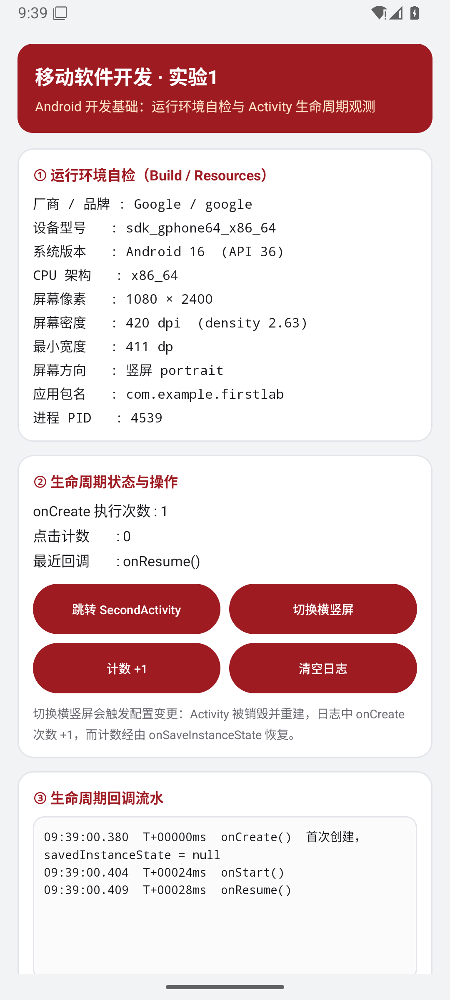
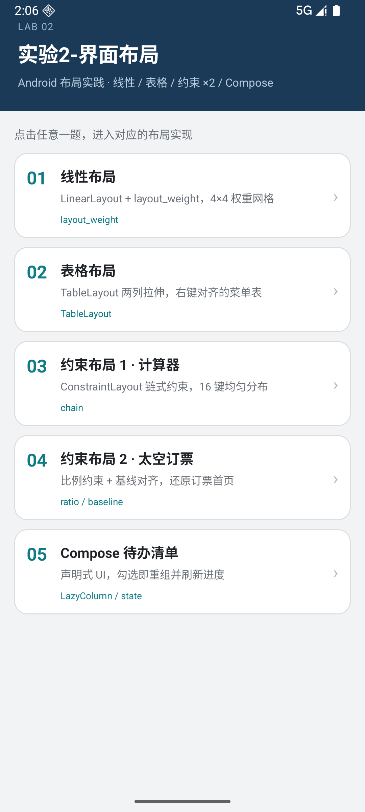
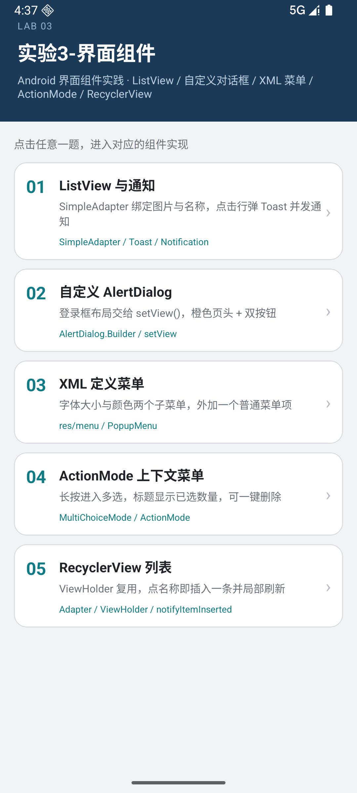
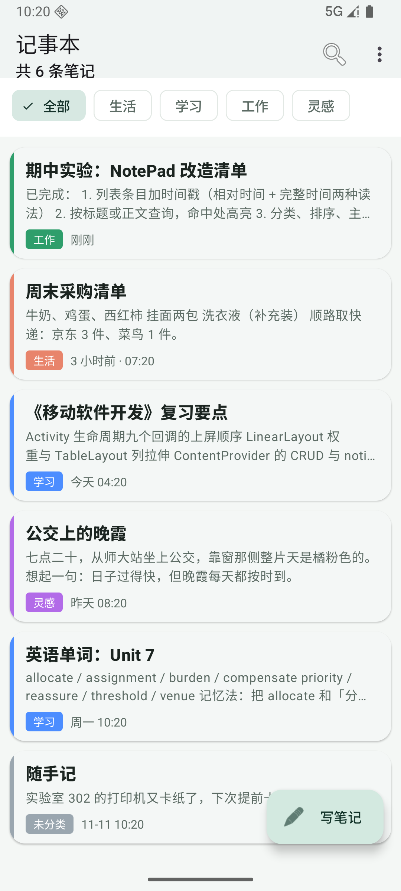

# 《移动软件开发》课程实验仓库

福建师范大学 · 计算机与网络空间安全学院 · 软件工程专业

本仓库按实验编号分目录存放，每个实验是一个**独立的 Gradle 工程**（各自的 SDK 版本、依赖互不干扰），根目录只放索引与通用忽略规则。

<table>
  <tr>
    <td align="center" width="33%">
      <br>
      <b>实验 1 · Android 开发基础</b><br>
      <sub>运行环境自检卡 + 生命周期观测台（9 个回调实时上屏）</sub>
    </td>
    <td align="center" width="33%">
      <br>
      <b>实验 2 · Android 界面布局</b><br>
      <sub>线性 / 表格 / 约束 ×2 / Compose 五题合一的目录式 App</sub>
    </td>
    <td align="center" width="33%">
      <br>
      <b>实验 3 · Android 界面组件</b><br>
      <sub>ListView / 自定义对话框 / 菜单 / ActionMode / RecyclerView 五题合一</sub>
    </td>
  </tr>
  <tr>
    <td align="center" colspan="3">
      <br>
      <b>期中实验 · NotePad 记事本应用</b><br>
      <sub>时间戳 + 标题/正文查询，另加主题、分类、排序、导出备份、偏好设置五类扩展</sub>
    </td>
  </tr>
</table>

运行环境：Android Studio + AGP 9.4.1 / Gradle 9.6 / JDK 21，实测机型为 `Pixel 7 · API 36`（Android 16）。

## 实验索引

| 编号 | 目录 | 主题 | 关键产出 | 博客 |
| --- | --- | --- | --- | --- |
| 实验 1 | [`lab1-android-basics/`](lab1-android-basics/) | Android 开发基础：运行环境、Activity 生命周期 | 运行环境自检卡 + 生命周期观测台（9 个回调全落地）、5 张实测截图、`logcat` 原始证据 | [CSDN · 实验1](https://blog.csdn.net/wjjj_ge/article/details/170988982) |
| 实验 2 | [`lab2-android-layout/`](lab2-android-layout/) | Android 界面布局：线性 / 表格 / 约束 ×2 / Compose | 五题合一的目录式 App、8 张实机截图、五套布局技法逐题说明 | [CSDN · 实验2](https://blog.csdn.net/wjjj_ge/article/details/170990569) |
| 实验 3 | [`lab3-android-components/`](lab3-android-components/) | Android 界面组件：ListView / 自定义对话框 / XML 菜单 / ActionMode / RecyclerView | 五题合一的目录式 App、18 张实机截图、Toast 与通知、多选删除、RecyclerView 局部刷新 | [CSDN · 实验3](https://blog.csdn.net/wjjj_ge/article/details/171045093) |
| 期中实验 | [`midterm-notepad/`](midterm-notepad/) | NotePad 记事本改造：时间戳、标题/正文查询，外加主题、分类、排序、导出备份、偏好设置 | ContentProvider 扩字段、搜索高亮、三套主题、排序单选对话框、Markdown 导出与 JSON 备份恢复（去重）、19 张实机截图 | 待发布 |

后续实验按 `lab4-xxx/`、`lab5-xxx/` 续加，并在上表补一行。

## 各实验说明

- **实验 1**：[`lab1-android-basics/README.md`](lab1-android-basics/README.md)
  - 把向导生成的 Hello World 改造成「运行环境自检 + 生命周期观测台」
  - 8 项设备/运行时信息（厂商、型号、API 级别、ABI、分辨率、dpi、最小宽度、方向、包名、PID）
  - 9 个 `Activity` 生命周期回调，每次输出「墙钟时间 + T+相对毫秒 + 回调名」，屏幕上直接可读
  - 四类场景实测：首次启动 / 页面跳转与返回 / 旋转（配置变更）/ 前后台切换

- **实验 2**：[`lab2-android-layout/README.md`](lab2-android-layout/README.md)
  - 线性布局：外层 4 行等高 + 内层 4 格按课件实测像素归一化的 `layout_weight`（21:33:24:22 等三套比例）
  - 表格布局：`stretchColumns="1"` 让快捷键贴右，`layout_span="2"` 跨列画分组细线
  - 约束布局 1：计算器 16 键四行横链（`spread` + 等权重），不嵌套 `LinearLayout`
  - 约束布局 2：太空订票首页，等权重页签、绿底等宽、白框压接缝、贴底 `DEPART`
  - Compose：`mutableStateListOf` + `LazyColumn` 的待办清单，勾选即重组，计数与删除线同步

- **实验 3**：[`lab3-android-components/README.md`](lab3-android-components/README.md)
  - ListView：`SimpleAdapter` 六行动物表（名称左、44dp 缩略图右、1dp 分隔线），点行弹 Toast 并发通知（自定义渠道 + 彩色 `largeIcon`）
  - 自定义 AlertDialog：`setView()` 塞整块登录框（橙头 `ANDROID APP` + 双输入框 + Cancel/Sign in），透明窗口固定 300dp 宽
  - XML 菜单：`res/menu` + `PopupMenu`，字号（10/16/20sp）与颜色（红/黑）两个 `single` 单选子菜单互斥，状态行同步
  - ActionMode：`CHOICE_MODE_MULTIPLE_MODAL` 多选，标题实时「N selected」，垃圾桶一键倒序删除
  - RecyclerView：`ViewHolder` 复用 + 稳定 id + `getBindingAdapterPosition()`，点名称插入一条并只刷新插入位置之后的序号

- **期中实验**：[`midterm-notepad/README.md`](midterm-notepad/README.md)
  - 基本要求：列表条目显示分级相对时间（刚刚 / x 分钟前 / 今天 / 昨天 / 周X / 日期），编辑页给完整时间
  - 基本要求：`SearchView` 按标题或正文查询，220ms 防抖，命中关键词黄底加粗高亮，摘要围绕命中处截取
  - 附加功能：白昼 / 夜间 / 护眼纸三套 Material3 主题；生活 / 学习 / 工作 / 灵感 / 未分类筛选；按修改时间 / 创建时间 / 标题三种排序
  - 附加功能：导出 Markdown 与备份 JSON 到 `Download/NotePad`，恢复按「同标题 + 同修改时间」去重，保留原时间戳
  - 附加功能：字号 12–24sp、默认排序、列表摘要开关等偏好设置
  - 数据层沿用 NotePad 的 ContentProvider 架构，表结构升到 v2 加 `category`，`notifyChange` + `ContentObserver` 自动刷新列表

## 实测要点（Android 16 / API 36）

| 场景 | 真实回调顺序 |
| --- | --- |
| 首次启动 | `onCreate → onStart → onResume` |
| 旋转屏幕 | `onPause → onStop → onSaveInstanceState → onDestroy → onCreate(重建) → onStart → onRestoreInstanceState → onResume` |
| 切到后台 | `onPause → onStop → onSaveInstanceState`（**`onStop` 先于 `onSaveInstanceState`**，与多数旧教程相反） |
| 从后台返回 | `onRestart → onStart → onResume`（实例没被回收，不重建） |

## 如何把某个实验跑起来

```powershell
cd lab1-android-basics
.\gradlew.bat installDebug          # 编译 + 安装到已连接的模拟器/真机
```

或直接双击 `lab1-android-basics\run-debug.bat`（编译 → 安装 → 重启 App → 打印新 PID）。

**判据**：App 首屏卡片里的「进程 PID」每次运行都不一样，才说明装的是新包。

## 环境

| 项 | 版本 |
| --- | --- |
| Android Studio | 2026.1.4 |
| AGP / Gradle | 9.4.1 / 9.6.0 |
| compileSdk / targetSdk / minSdk | 37 / 37 / 24 |
| JDK | 21 |
| 模拟器 | AVD Pixel7API36（Android 16 / API 36 / x86_64 / 1080×2400 @420dpi） |

## 目录约定

```
fjnu-mobile-app-dev-labs/
├─ README.md                 课程索引（本文件）
├─ .gitignore                整门课通用忽略规则
└─ lab1-android-basics/      实验1（独立 Gradle 工程）
   ├─ README.md              该实验的说明与实测结论
   ├─ app/                   源码、布局、资源
   ├─ docs/screenshots/      证据截图
   ├─ logcat-Lab1Lifecycle.txt
   └─ run-debug.bat          一键编译安装
```

`lab2-android-layout/`、`lab3-android-components/`、`midterm-notepad/` 结构同上，各自是能独立构建的 Gradle 工程。

每个实验完成后打一个 tag（`lab1`、`lab2`、`lab3`、`midterm`），方便按版本点开查看当时的完成状态。

## 提交与版本约定

- **每个实验一条主体提交**：标题只写 `实验 N：主题`，实现细节、修正记录、截图数量全部放进提交正文，避免标题被某一次修 bug 的提交顶掉；
- **同一实验的收尾/修正提交沿用 `实验 N：` 前缀**，不另起标题、不并入主体提交（例如实验2 的收尾提交），这样目录行始终读成「实验 N：主题」；
- **提交正文写「这个实验做了什么」**：逐题列练到的知识点、实测结论与修正记录；补链接、改索引、加署名这类文档改动不写进实验提交的正文（GitHub 上悬停目录行读到的就是这段正文）；
- **每个实验完成打一个 tag**（`lab1`、`lab2`、`lab3`、期中实验用 `midterm`），按包名进对应提交；
- **仓库层面的改动**（索引、目录约定、说明）单独用 `课程仓库：…` 前缀提交，不混进某个实验的提交里。

## 作者

**wjjj-ge**（[@wjjj-ge](https://github.com/wjjj-ge)）· 福建师范大学 · 计算机与网络空间安全学院 · 软件工程专业

课程：《移动软件开发》· 2026 年秋季学期
