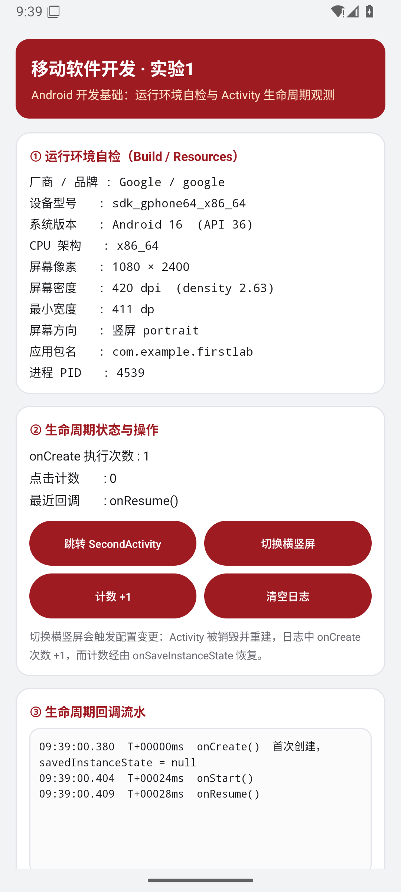
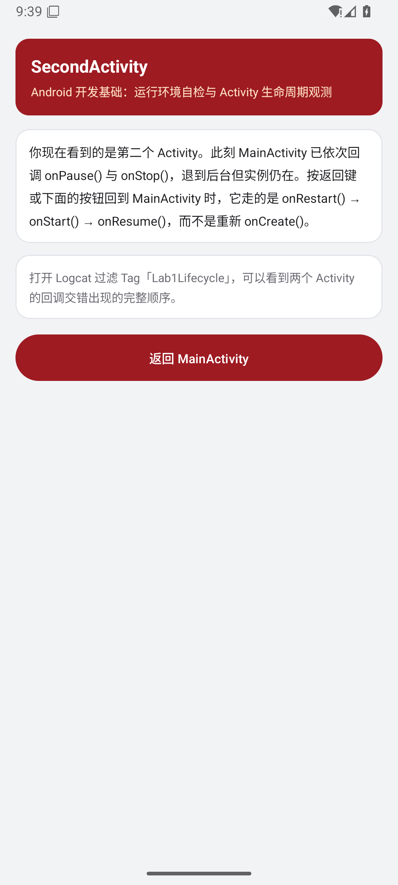
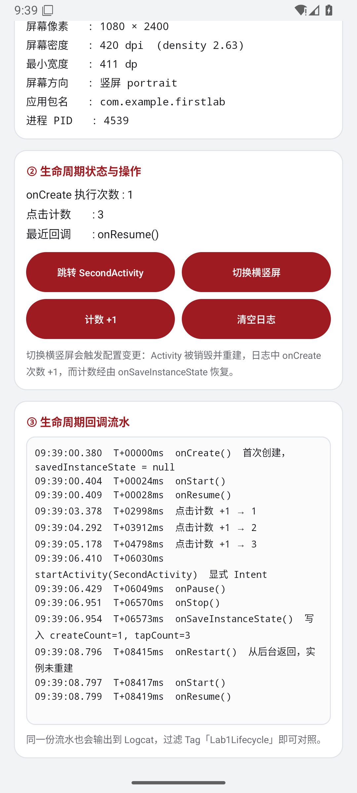
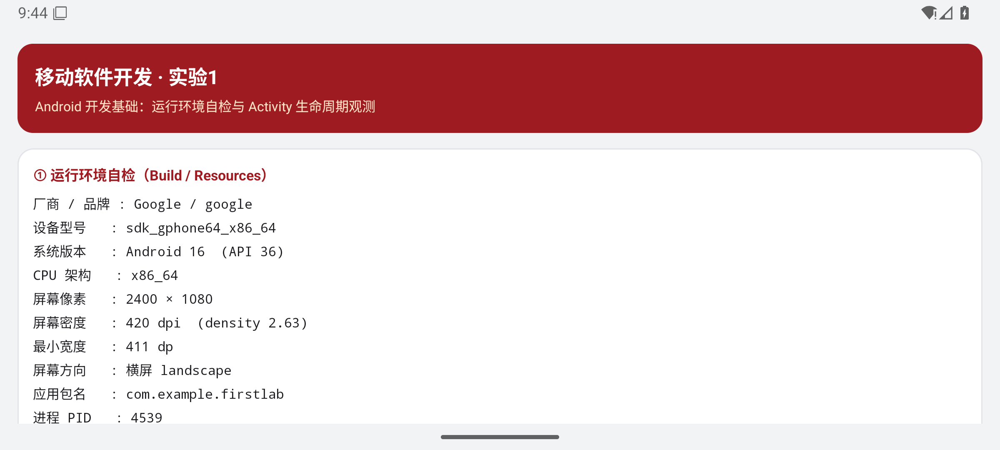
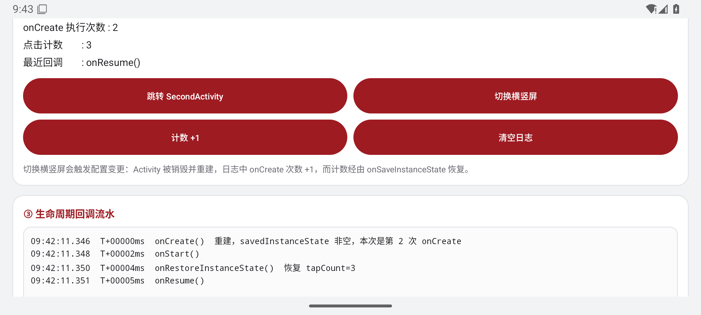

# FirstLab · Android 运行环境自检与 Activity 生命周期观测台

福建师范大学 · 移动软件开发 · 实验1（Android 开发基础）

把默认的 `Hello World` 工程改造成一块「生命周期观测台」：Activity 的每一次 `onCreate` / `onStart` / `onResume` / `onPause` / `onStop` / `onRestart` / `onDestroy` / `onSaveInstanceState` / `onRestoreInstanceState` 都会带时间戳打在屏幕上，同时输出到 Logcat。

## 功能

- **运行环境自检**：读取 `Build` 与 `Resources`，打印厂商/品牌、型号、系统版本与 API 级别、CPU ABI、屏幕像素、densityDpi、density、最小宽度 dp、当前屏幕方向、应用包名、进程 PID。
- **生命周期观测**：9 个回调全部重写，每条记录格式为 `墙钟时间 HH:mm:ss.SSS + T+相对毫秒 + 回调名`；相对零点用 `SystemClock.elapsedRealtime()`（开机以来的单调时钟），不受系统时间调整影响。
- **主动制造事件**：四个按钮 —— 跳转 `SecondActivity`（触发 `onPause/onStop`）、切换横竖屏（触发配置变更与 Activity 重建）、计数 +1、清空日志。
- **状态跨重建存活**：`createCount` 与 `tapCount` 写入 `Bundle`，旋转后 `onCreate 执行次数` 递增、点击计数不归零。

## 环境

| 项 | 值 |
| --- | --- |
| Android Studio | 2026.1.4 |
| AGP / Gradle / JDK | 9.4.1 / 9.6.0 / 21 |
| compileSdk / minSdk / targetSdk | 37 / 24 / 37 |
| 语言 | Java（source/target 11） |
| 测试设备 | AVD `Pixel7API36`：Android 16（API 36）、x86_64、1080×2400 @420dpi |

## 运行

1. 用 Android Studio 打开本工程，等待 Gradle Sync。
2. 启动模拟器（`Pixel7API36`）或连接真机。
3. Run 'app'；Logcat 过滤 `tag:Lab1Lifecycle` 可看到两个 Activity 的交错回调。

命令行等价操作：

```powershell
$adb = "D:\Android\Sdk\platform-tools\adb.exe"
$emu = "D:\Android\Sdk\emulator\emulator.exe"
& $emu -avd Pixel7API36 -no-audio -no-boot-anim -no-snapshot -gpu swiftshader_indirect -accel on
& $adb wait-for-device
& $adb install -r app\build\outputs\apk\debug\app-debug.apk
& $adb shell am start -n com.example.firstlab/.MainActivity
& $adb logcat -s Lab1Lifecycle
```

## 实测回调序列（Android 16）

| 场景 | 序列 |
| --- | --- |
| 首次启动 | `onCreate` → `onStart` → `onResume` |
| 跳转 SecondActivity | `Main.onPause` → `Second.onCreate` → `Second.onStart` → `Second.onResume` → `Main.onStop` → `Main.onSaveInstanceState` |
| 返回 Main | `Second.onPause` → `Main.onRestart` → `Main.onStart` → `Main.onResume` → `Second.onStop` → `Second.onDestroy` |
| 切换横竖屏 | `onPause` → `onStop` → `onSaveInstanceState` → `onDestroy` → `onCreate`（新实例）→ `onStart` → `onRestoreInstanceState` → `onResume` |

> 注意：Android 9（P）起 `onSaveInstanceState` 被挪到 `onStop` 之后，与不少旧教程「先存后停」的画法相反。本仓库的日志即实测证据（`logcat-Lab1Lifecycle.txt`）。

## 截图

| 首屏 | SecondActivity | 返回后完整流水 |
| --- | --- | --- |
|  |  |  |

| 横屏（方向证据） | 横屏（状态与日志同框） |
| --- | --- |
|  |  |

## 目录

```
app/src/main/java/com/example/firstlab/MainActivity.java    自检 + 观测 + 事件源
app/src/main/java/com/example/firstlab/SecondActivity.java  把 Main 推到后台的配角
app/src/main/res/layout/activity_main.xml                   三张卡片：自检 / 状态 / 日志
app/src/main/res/layout/activity_second.xml                 说明页 + 返回按钮
logcat-Lab1Lifecycle.txt                                    实测日志（两次独立复现）
```

## 作者

福建师范大学 软件工程专业 · 移动软件开发课程
