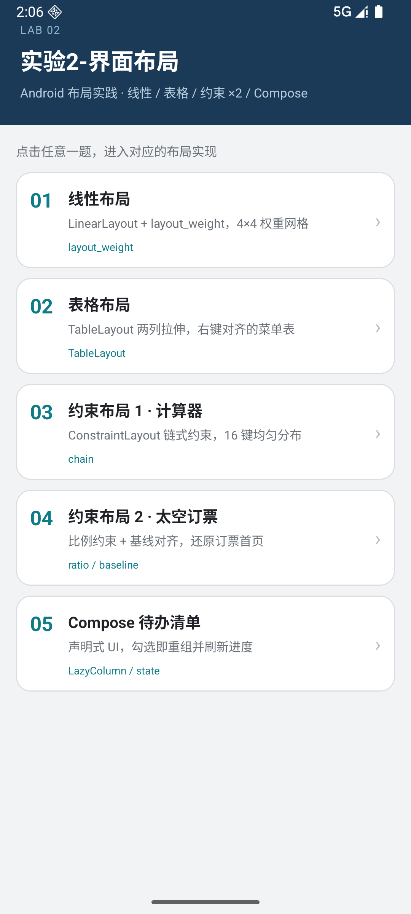
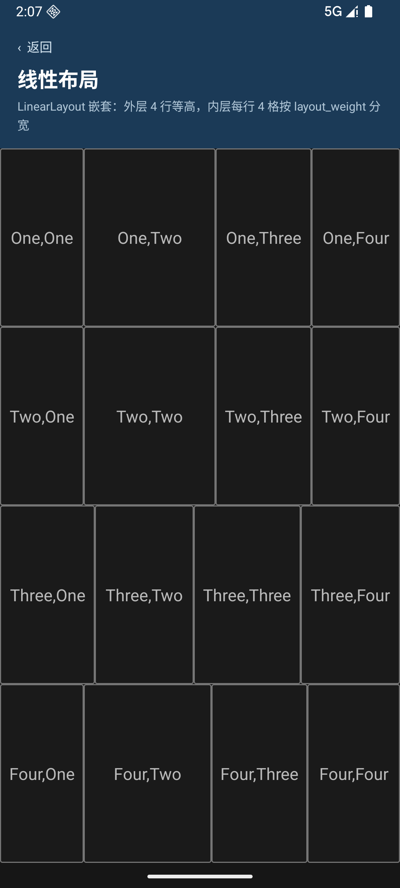
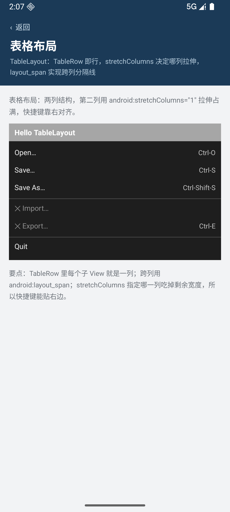
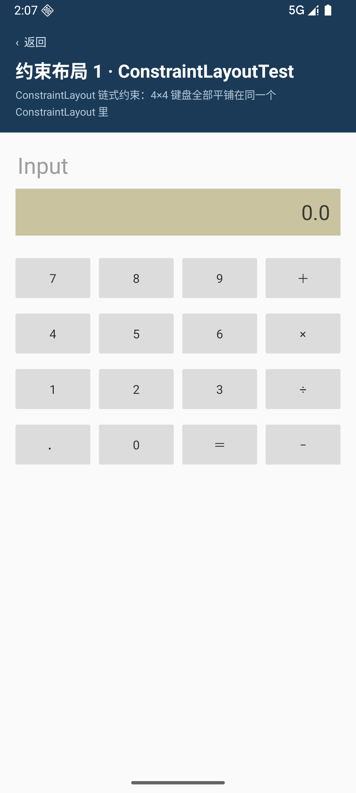
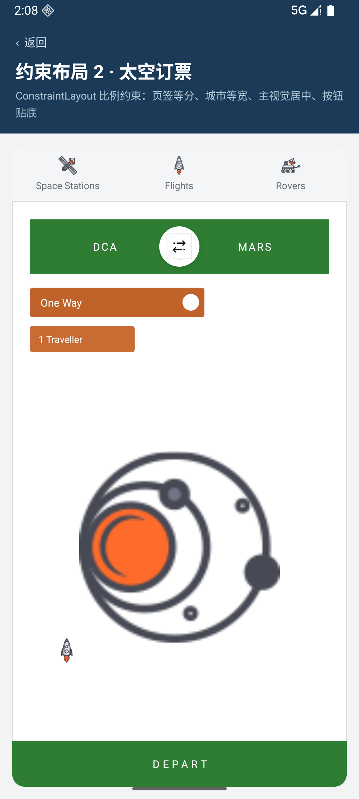
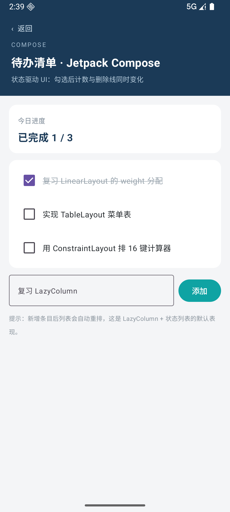
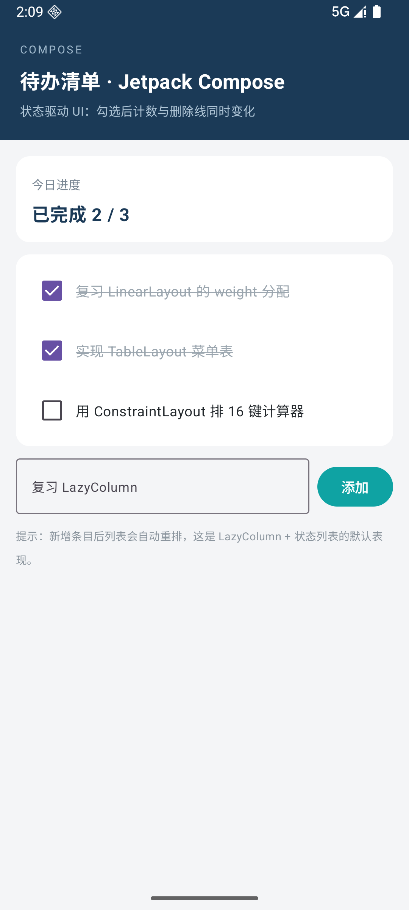
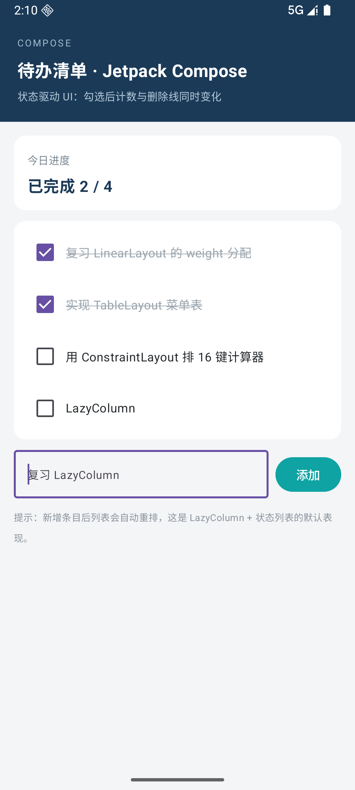
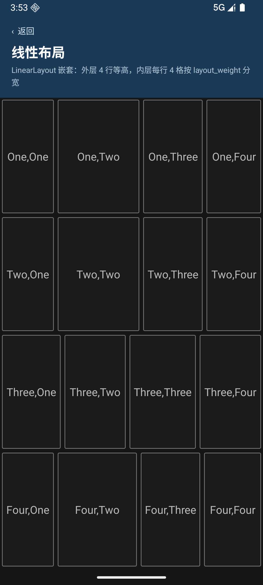

# 实验2 · Android 界面布局（Lab2Layout）

《移动软件开发》实验二：用线性布局、表格布局、约束布局完成课件上的四道界面题，再补一个 Compose 版待办清单做对照。五个界面在同一个工程里，首页是题目目录，点卡片进对应实现。

> **交付状态：已完成**（tag `lab2`）。五题全部实现并实机验证，9 张截图见 `docs/screenshots/`（含 Compose 页「‹ 返回」入口的修复后版本、线性布局 margin 对照实验），`run-debug.bat` 可一键编译安装。
>
> **图文版实验记录**：[CSDN · Android 界面布局实战](https://blog.csdn.net/wjjj_ge/article/details/170990569)

| 序号 | 界面 | 主要练的东西 | 源码 |
| --- | --- | --- | --- |
| 01 | 线性布局 · 4×4 权重网格 | 嵌套 `LinearLayout` + `layout_weight` 双轴分配 | `activity_linear.xml` |
| 02 | 表格布局 · 菜单表 | `TableLayout` / `stretchColumns` / `layout_span` | `activity_table.xml` |
| 03 | 约束布局 1 · 计算器 | 横向链（chain，spread + 等权重），16 键不嵌套 | `activity_constraint_one.xml` |
| 04 | 约束布局 2 · 太空订票 | 比例约束、等权重、`FrameLayout` 叠层压接缝 | `activity_constraint_two.xml` |
| 05 | Compose · 待办清单 | 声明式 UI、`mutableStateListOf`、`LazyColumn` | `TodoActivity.kt` |

## 截图

| 目录页 | 线性布局 |
| --- | --- |
|  |  |

| 表格布局 | 计算器 |
| --- | --- |
|  |  |

| 太空订票 | Compose 初始态 |
| --- | --- |
|  |  |

| 勾选两项后 2/3 | 新增一条后 2/4 |
| --- | --- |
|  |  |

| 对照：每格加 3dp margin（双线夹缝） |
| --- |
|  |

最后一张是对照实验的产物：同一页面只改 `layout_margin` 一项，格子交界处就从「一条 6px 亮线」变成「两条 3px 亮线夹 16px 底色」。测量方法见博客第二节。

## 各题的关键做法

### 01 线性布局：权重怎么定

行高用外层 `LinearLayout` 的 4 个 `layout_weight="1"` 均分；每行内部 4 格再按课件截图实测的像素宽度归一化成权重：

| 行 | 课件实测宽（px） | 归一化权重 |
| --- | --- | --- |
| 第 1、2 行 | 247 / 402 / 284 / 263 | 21 : 33 : 24 : 22 |
| 第 3 行 | 285 / 293 / 321 / 300 | 24 : 25 : 27 : 25 |
| 第 4 行 | 256 / 378 / 292 / 271 | 21 : 32 : 24 : 23 |

格子之间不加 margin，靠每个格子自己的 1dp 描边拼出共用边线，这样才和课件的连续网格一致。

### 02 表格布局：两列 + 跨列分隔线

`TableLayout` 设 `stretchColumns="1"`：第 1 列按内容宽度走，第 2 列吃掉剩余宽度，快捷键（`Ctrl-O` / `Ctrl-S` / `Ctrl-Shift-S` / `Ctrl-E`）就自然贴右。分组之间的细线是一行 `<View>`，`layout_span="2"` 跨两列。

### 03 约束布局 1：16 键全靠链

四行按键，每行是一条水平链：四个键 `layout_width="0dp"` + `layout_constraintHorizontal_weight="1"`，首尾键分别连父容器左右边，`chainStyle="spread"`。行与行之间只让每行第一个键去约束「上一行第一个键的底部」，其余键 `top` 对齐本行第一个键，不再嵌套任何 `LinearLayout`。

按键符号按课件截图排布为 `7 8 9 ＋ / 4 5 6 × / 1 2 3 ÷ / ．0 ＝ －`，16 个键正好是 10 个数字 + 小数点 + 四个运算符 + 等号。

### 04 约束布局 2：白框压接缝的还原

- 页签三等分：`LinearLayout` 三个 `layout_weight="1"` 子项，每个子项内图标 + 文字竖排；
- 出发地 / 目的地：`FrameLayout` 里先放两个等权重绿底 `TextView`，再把 46dp 的白色圆角小方框 `layout_gravity="center"` 叠上去，方框带 `elevation="3dp"`，视觉上正好骑在两块绿底的接缝上；
- 主视觉：`galaxy.png` 230dp，`top` 连 `1 Traveller` 底部、`bottom` 连 `DEPART` 顶部、`verticalBias="0.5"` 居中；小火箭 `bottom` 对齐星球底部、`end` 对齐星球左边，`translationY="18dp"` 往下压一点；
- `DEPART`：`0dp` 宽度贴满卡片底，背景用只带下圆角的 `depart_bottom.xml`，避免方形按钮顶破 14dp 圆角卡片；页签顶部同理用 `tab_bar_top.xml`。

### 05 Compose：声明式 UI 的最小样本

`TodoActivity.kt` 里没有一行 XML：

- 状态用 `mutableStateListOf<TodoItem>`，勾选时用 `todos[index] = item.copy(done = checked)` 替换元素，触发重组；
- `doneCount = todos.count { it.done }` 跟着重组自动更新，"已完成 x / y" 与删除线同时变化；
- 列表用 `LazyColumn`，输入框 + `Button` 用 `Row` 排，新增后自动重排。

注意一项容易被忽略的事：Compose 页的页头是自己在 Kotlin 里画的，**没有 XML 版 `view_header` 里那个返回按钮**，所以「‹ 返回」也得自己补——一个 `Text` 加 `Modifier.clickable(onClick = onBack)`，`onBack` 传 `finish()` 即可。少了这一行，页面就只能靠系统返回键退出。

## 构建与运行

最快的路径：启动模拟器后，直接双击本目录下的 `run-debug.bat`（先 `--stop` 清守护进程，再 `installDebug`，最后重启 App 并打印 PID）。脚本输出里 PID 每次都不一样，就说明装的是新包。

手动三步：

```powershell
# 工程根目录
.\gradlew.bat --stop          # 先停掉 IDE 拉起的守护进程（见踩坑 1）
.\gradlew.bat assembleDebug

adb install -r app\build\outputs\apk\debug\app-debug.apk
adb shell am start -n com.example.lab2layout/.MainActivity
```

包名 `com.example.lab2layout`，应用名「实验2-界面布局」，`minSdk 24` / `targetSdk 37`，AGP 9.4.1 + Gradle 9.6.0。

## 踩坑记录

1. **IDE 进程树被联想火绒拦截**：Android Studio 自己拉起的 Gradle 守护进程下，`aapt2` / `adb` 子进程会被杀，表现为构建或安装莫名失败。解法是先 `gradlew --stop`，再用命令行构建（实验1 的 `run-debug.bat` 已内置这一步）。
2. **`aapt2FromMavenOverride`**：`gradle.properties` 里指向本机 `build-tools\36.0.0\aapt2.exe`，绕开镜像下载的 aapt2 与火绒的冲突。
3. **AGP 9 内置 Kotlin**：AGP 9.4.1 已经在 classpath 上带了 Kotlin（2.2.10），再 `apply plugin: 'org.jetbrains.kotlin.android'` 会直接报 `Cannot add extension with name 'kotlin'`。Compose 只需要额外加 `org.jetbrains.kotlin.plugin.compose`（版本必须与内置 Kotlin 对齐，这里写 `2.2.10`）+ `buildFeatures { compose = true }`。
4. **启动图标资源缺失**：从实验1 复制工程骨架时只搬了 `mipmap-*`，`drawable/ic_launcher_background.xml`、`ic_launcher_foreground.xml` 漏了，`processDebugResources` 报 `resource drawable/ic_launcher_background not found`。补齐即可。
5. **API 36 强制 edge-to-edge**：状态栏是透明的，页面根布局一加 `fitsSystemWindows` 就会在顶部留一条和页面背景同色的空条——计算器页是浅色底，白图标直接看不见。最终改成不加 `fitsSystemWindows`，让 navy 页头自己铺到状态栏底下，并把页头 `paddingTop` 提到 34dp 让标题避开状态栏图标。
6. **`uiautomator dump` 拿不到 Compose 控件的 id**：Compose 节点没有 `resource-id`，只能按 `class=CheckBox` / `EditText` / `Button` 的 `bounds` 取坐标点击。

## 目录结构

```
lab2-android-layout/
├─ app/src/main/
│  ├─ java/com/example/lab2layout/
│  │  ├─ BaseDemoActivity.java      页头绑定（返回键 / 标题 / 副标题）
│  │  ├─ MainActivity.java          目录页，五张卡片跳转
│  │  ├─ LinearLayoutActivity.java
│  │  ├─ TableLayoutActivity.java
│  │  ├─ ConstraintOneActivity.java
│  │  ├─ ConstraintTwoActivity.java
│  │  └─ TodoActivity.kt            Compose 待办
│  └─ res/
│     ├─ layout/                    view_header + activity_main + 四个布局页
│     ├─ drawable/                  卡片、色块、圆角、素材图标
│     └─ values/                    colors / strings / themes
└─ docs/screenshots/                实机运行截图（1080×2400）
```

## 界面素材

`double_arrows.png`、`galaxy.png`、`rocket_icon.png`、`rover_icon.png`、`space_station_icon.png`、`single_arrow.png` 来自课程群文件「实验2图片」压缩包，已放进 `res/drawable/`。

## 作者

**wjjj-ge**（[@wjjj-ge](https://github.com/wjjj-ge)）· 福建师范大学 · 计算机与网络空间安全学院 · 软件工程专业

课程：《移动软件开发》· 2026 年秋季学期 · 实验2（Android 界面布局）
