# 实验3 · Android 界面组件（Lab3Components）

《移动软件开发》实验三：ListView（SimpleAdapter + Toast + 通知）、自定义 AlertDialog（`setView()`）、XML 定义菜单（PopupMenu + 两个子菜单）、ActionMode 上下文菜单、RecyclerView（Adapter + ViewHolder + 局部刷新）。五道题在同一个工程里，首页是题目目录，点卡片进对应实现。

> **交付状态：已完成**（tag `lab3`）。五题全部实现并实机验证，18 张截图见 `docs/screenshots/`，`run-debug.bat` 可一键编译安装。
>
> **图文版实验记录**：CSDN · Android 界面组件实战（见博客链接，发布后回填）

| 序号 | 组件 | 主要练的东西 | 源码 |
| --- | --- | --- | --- |
| 01 | ListView + 通知 | `SimpleAdapter` 自定义行布局、Toast、NotificationChannel、运行时权限 | `ListViewActivity.java` |
| 02 | 自定义 AlertDialog | `AlertDialog.Builder.setView()` 塞整块布局、透明窗口、非空校验 | `DialogActivity.java` |
| 03 | XML 定义菜单 | `res/menu` + `PopupMenu`、二级子菜单、`single` 单选组互斥与勾选态 | `MenuActivity.java` |
| 04 | ActionMode 上下文菜单 | `CHOICE_MODE_MULTIPLE_MODAL` + `MultiChoiceModeListener`、标题实时改数量 | `ActionModeActivity.java` |
| 05 | RecyclerView | `Adapter` + `ViewHolder`、稳定 id、`getBindingAdapterPosition()`、`notifyItemInserted` + 范围刷新 | `RecyclerActivity.java` / `AnimalAdapter.java` |

## 截图

| 目录页 | 第1题 · 列表 |
| --- | --- |
| 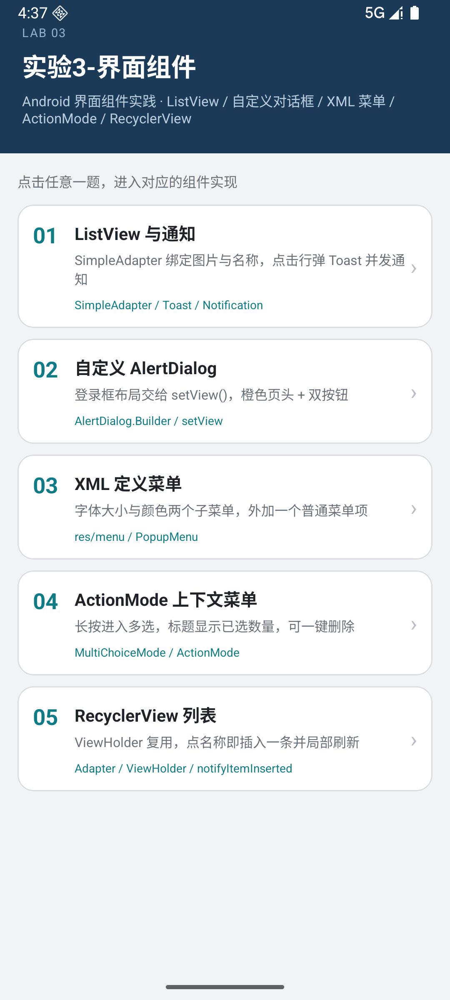 | 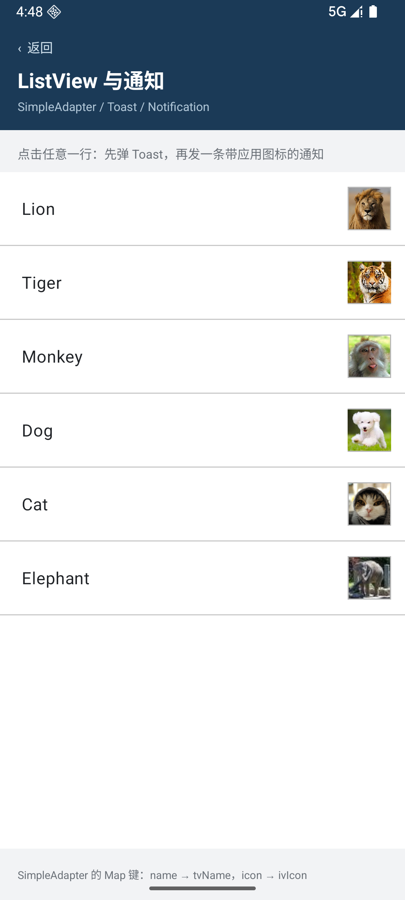 |

| 点行弹 Toast | 点击后发通知 |
| --- | --- |
| 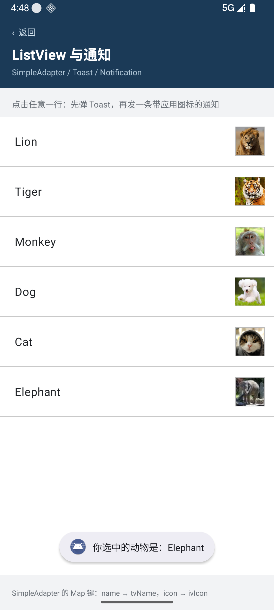 | 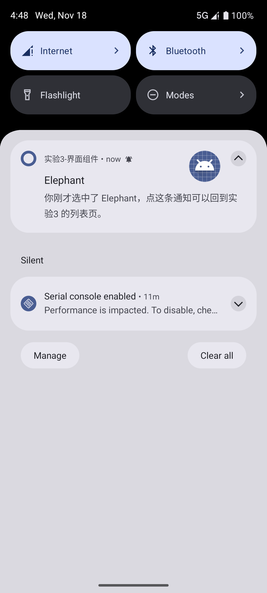 |

| 第2题 · 对话框入口 | 自定义 AlertDialog |
| --- | --- |
| 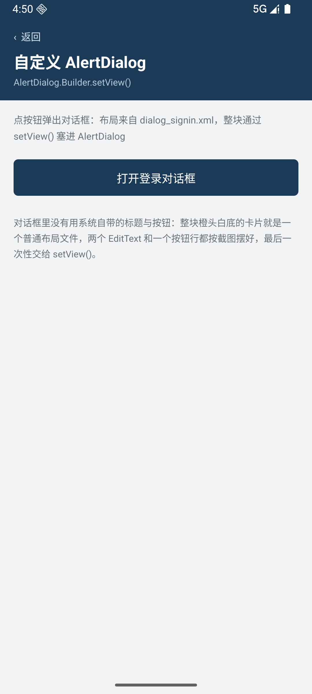 | 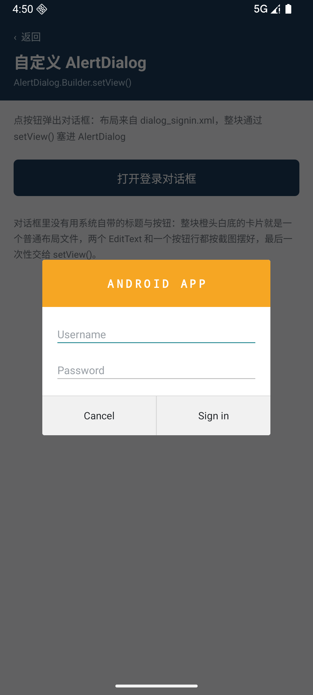 |

| 填好账号密码 | 第3题 · 菜单页初始态 |
| --- | --- |
| 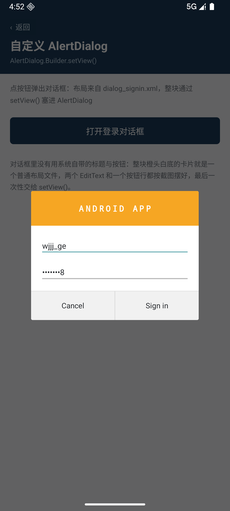 | 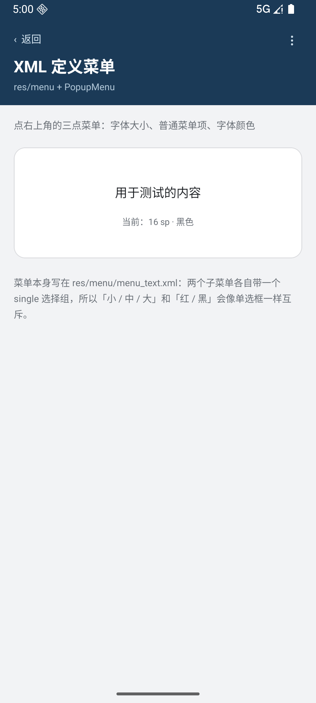 |

| 主菜单（两个子菜单 + 普通项） | 字体大小子菜单（中已选中） |
| --- | --- |
| 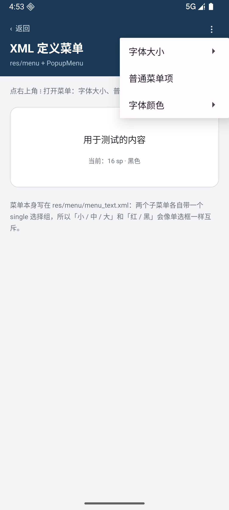 | 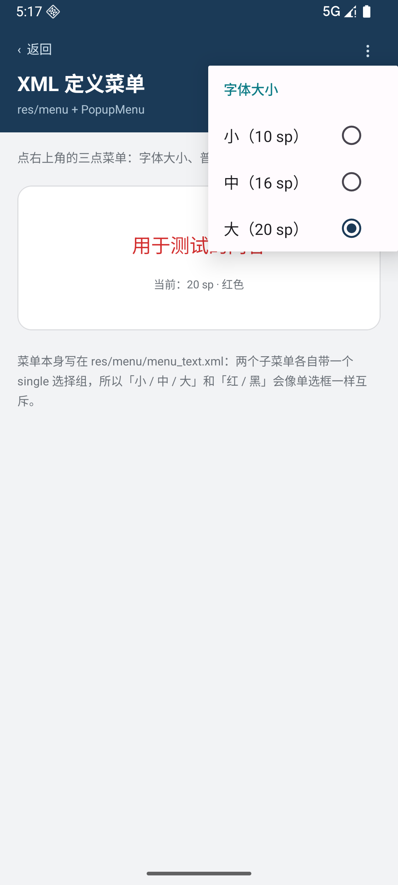 |

| 字体颜色子菜单（黑已选中） | 选完「大 + 红」的最终态 |
| --- | --- |
|  | 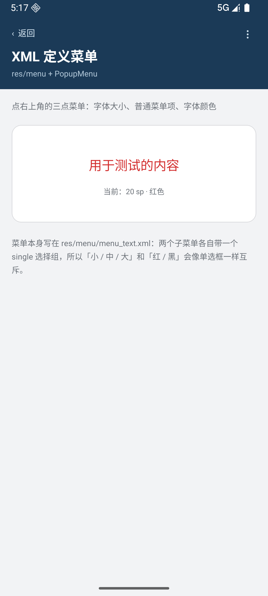 |

| 第4题 · 列表 | 长按进入 ActionMode，多选 2 项 |
| --- | --- |
| 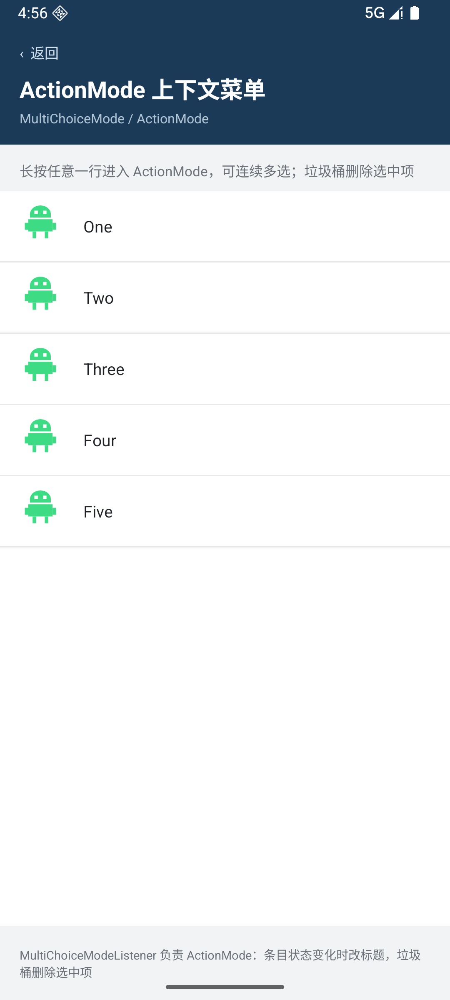 | 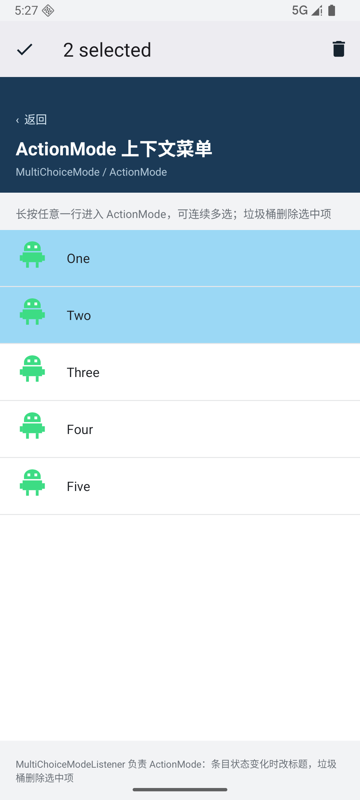 |

| 垃圾桶删除后（剩 Three / Four / Five） | 第5题 · RecyclerView 初始 6 条 |
| --- | --- |
| 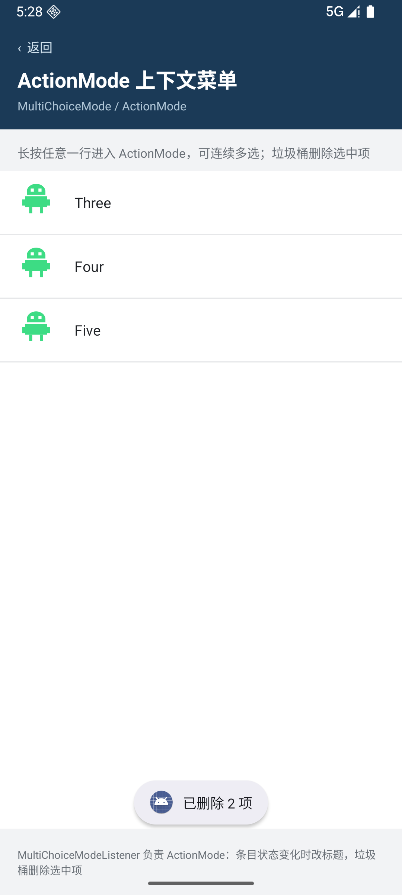 | 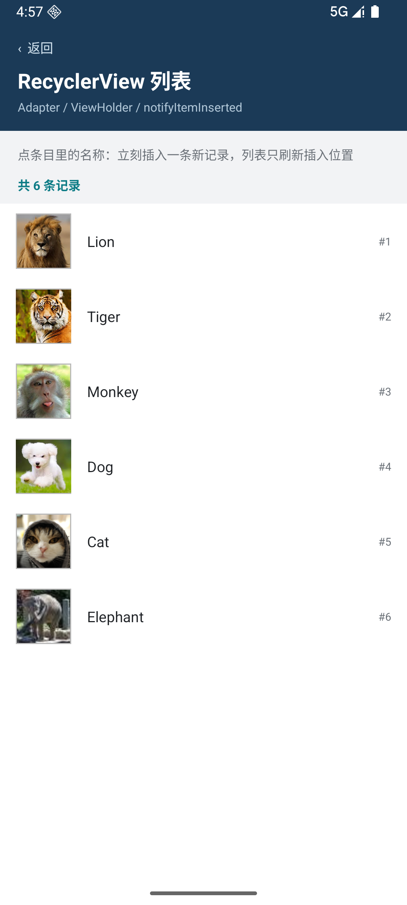 |

| 点名称插入一条（7 条，序号顺延） | 插到 11 条后滚动到底（图不串行） |
| --- | --- |
| 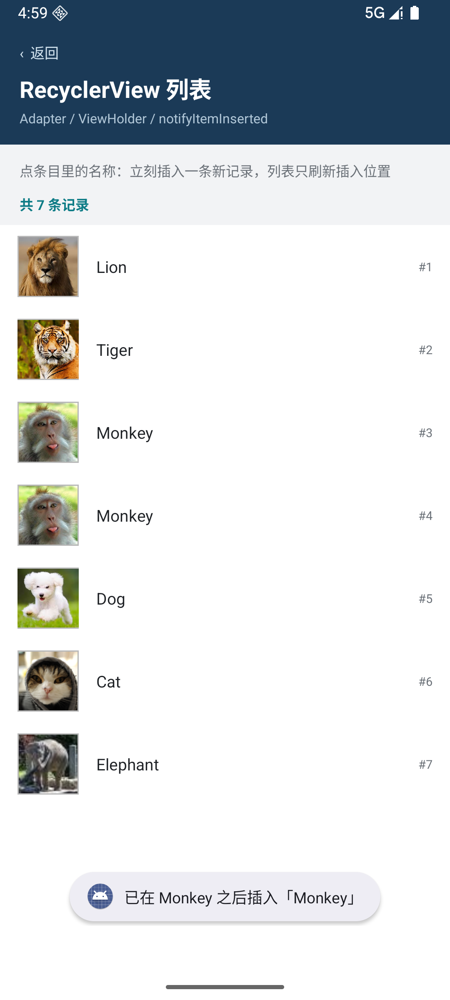 | 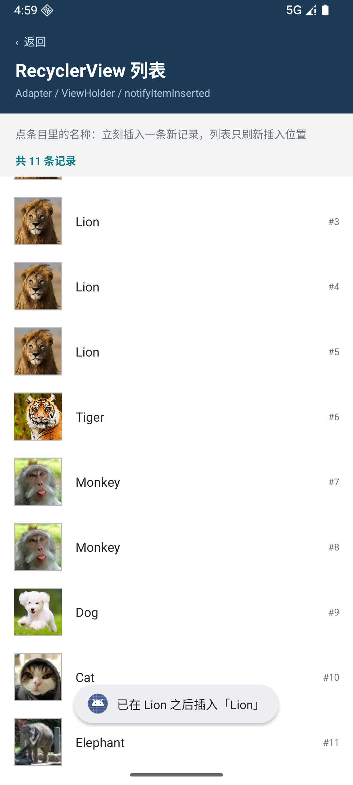 |

## 各题的关键做法

### 01 ListView：SimpleAdapter + Toast + 通知

- 行布局 `item_animal.xml`：名称在左、44dp 缩略图在右（细边框 + 内边距），行高 72dp，行间 1dp 分隔线在下层 `ListView` 上用 `divider` 画。
- 数据用 `SimpleAdapter`，`from = {name, photo}`、`to = {tvName, ivThumb}`，名称和图片两个 `TextView`/`ImageView` 的 id 必须和数据键一一对应。
- 选中行暗红底白字：`item_bg_list.xml` 做背景 selector，文字颜色用 **`res/color/item_text_list.xml`** 的 `ColorStateList`（`state_pressed` / `state_activated` 两种态分别给白色）。
- 点行：先弹 Toast「你选中的动物是：X」，再发一条通知。通知渠道在 `onCreate` 里建（渠道 id `lab3_list`，重要性 `IMPORTANCE_DEFAULT`）；Android 13+ 还要 `POST_NOTIFICATIONS` 运行时权限，首次进入列表页申请。
- 通知的小图标只能是单色剪影，所以 `setSmallIcon(R.mipmap.ic_launcher)` 之外，另取 `getPackageManager().getApplicationIcon()` 转 Bitmap 交给 `setLargeIcon()`，通知栏里才是彩色的应用图标。
- 点通知回列表页：`PendingIntent` 指向 `ListViewActivity`，`setFlags(FLAG_UPDATE_CURRENT | FLAG_IMMUTABLE)`。

### 02 自定义 AlertDialog：`setView()` 塞整块布局

- `dialog_signin.xml` 以 `LinearLayout` 为根：橙色页头 62dp（`ANDROID APP`，字距拉开的等距字体）+ 两个下划线输入框 + 底部 `Cancel | Sign in` 两等分按钮行。
- `AlertDialog.Builder(this).setView(view).create()`，再 `window.setBackgroundDrawableResource(android.R.color.transparent)` 去掉系统默认白底，`window.setLayout(300dp, WRAP_CONTENT)` 固定宽度。
- 两个按钮都手动 `dismiss()`；`Sign in` 先做非空校验，空则 `setError`，非空才提示登录成功。

### 03 XML 定义菜单：PopupMenu 的两个子菜单

- 菜单写在 `res/menu/menu_text.xml`：`字体大小`（子菜单 小 10sp / 中 16sp / 大 20sp）、`普通菜单项`、`字体颜色`（子菜单 红 / 黑）。
- 两个子菜单各自带一个 `android:checkableBehavior="single"` 的组，所以组内天然互斥；当前态用 `item.setChecked(true)` 画成单选圆圈。
- 页面顶部的「⋮」按钮是 `view_header.xml` 里 `btnOverflow`，默认 `gone`，只有菜单页调 `showOverflow()` 才显示；`PopupMenu` 锚在它身上。
- 字号/颜色一改，正文和状态行「当前：20 sp · 红色」同步刷新，用同一份状态变量算文案，避免两处不一致。
- **每次弹出前都要恢复勾选**：`PopupMenu` 每次都是一个新 inflate 出来的 `Menu`，上一轮 `item.setChecked(true)` 的结果不会留在里面。不处理的话会出现「正文已经是 20 sp 红色、菜单里却还勾着中号 / 黑色」的错位。做法是弹出前先按当前状态 `syncChecked(menu)`，再把菜单 show 出来。

### 04 ActionMode：多选与一键删除

- `ListView` 设 `choiceMode = CHOICE_MODE_MULTIPLE_MODAL`，再 `setMultiChoiceModeListener()`；`ActionMode.Callback` 里 `onCreateActionMode` 返回 `true` 才会进多选态。
- 菜单用 `res/menu/menu_action.xml`：勾（`showAsAction="always"`，点了就 `finish()` 退出多选）+ 垃圾桶（删掉所有 `getCheckedItemPositions()` 里为 `true` 的行）。
- 标题用 `String.format("%d selected", count)`，在 `onItemCheckedStateChanged` 里实时改；`onDestroyActionMode` 里清空勾选。
- 选中行浅蓝底：`row_selectable.xml`（`activated` 态给 `#9BD8F5`），`ListView` 的 `listSelector` 也指向它。
- 菜单里**只放垃圾桶一项**。左上角那个勾是 ActionMode 自带的关闭按钮（`android:actionModeCloseDrawable` 决定它长什么样），它的动作也是 `finish()`；再放一个「完成」项就会出现两个勾、效果还一样。
- 操作栏在 `Theme.Material3.Light.NoActionBar` 下是系统默认的浅灰底，盖在浅底上的图标必须是深色的（`ic_check_dark.xml` / `ic_delete_dark.xml`，`#16232F`）。
- 操作栏还会**盖住状态栏区域**（本工程是 edge-to-edge），而状态栏图标平时是白色（页头是深 navy）。所以进入多选态时用 `WindowCompat.getInsetsController(...).setAppearanceLightStatusBars(true)` 把状态栏图标切成深色，`onDestroyActionMode` 里再切回白色，否则就是白字压浅底。
- 删除必须**倒序**删：正序删会让后面的索引整体前移，删一半就错位。

### 05 RecyclerView：插入一条只刷新插入位置

- `item_recycler.xml`：左侧圆角缩略图 88dp，中间名称，右侧 `#序号` 徽标。
- `AnimalAdapter` 用 `ViewHolder` 复用，`setHasStableIds(true)` + `getItemId()` 返回每条记录自己的 id；点击只挂在「名称」这一个控件上，取 `getBindingAdapterPosition()`，插入后点到的仍是屏幕上那一条。
- 点击 → 在 `position + 1` 处插入同图同名的新记录 → `notifyItemInserted(position + 1)`。
- **序号徽标是按 position 算的**，只 `notifyItemInserted` 的话，后面那些行不会重新绑定，序号会停在旧值（表现为「两个 #4」）。补一句 `notifyItemRangeChanged(position + 1, size - position - 1)` 才顺延正确，同时仍然只刷新插入点之后的行，不影响插入点之前的复用。

## 构建与运行

最快的路径：启动模拟器后，直接双击本目录下的 `run-debug.bat`（`installDebug` → 重启 App）。**不要在 Android Studio 的终端里跑**，IDE 拉起的 Gradle 守护进程下的子进程会被联想火绒拦（见踩坑 1）。

手动三步：

```powershell
# 工程根目录
.\gradlew.bat --stop
.\gradlew.bat assembleDebug --console=plain

adb install -r app\build\outputs\apk\debug\app-debug.apk
adb shell am start -n com.example.lab3components/.MainActivity
```

包名 `com.example.lab3components`，应用名「实验3-界面组件」，`minSdk 24` / `targetSdk 37`，AGP 9.4.1 + Gradle 9.6.0，全部 Java 实现（无 Compose、无 Kotlin 源码）。

## 踩坑记录

1. **IDE 进程树被联想火绒拦截**：AS 终端里 `gradlew` / `adb` 会被当子进程杀掉，表现为构建或安装莫名失败。解法是命令行构建，`run-debug.bat` 里已经内置。
2. **`textColor` 指向 drawable 会渲染成洋红**：`ColorStateList` 必须放在 `res/color/` 下，而且语法是 `<item android:color="…" android:state_pressed="true"/>`，不能写成 drawable 那种 `<item><color …/></item>`。写错时 Android 不报错，直接把文字画成洋红——**洋红就是「资源解析失败」的信号灯**。
3. **通知小图标被压成单色剪影**：`setSmallIcon()` 只吃 alpha，想显示彩色应用图标得用 `setLargeIcon()` 传 Bitmap。
4. **`⋮`（U+22EE）在系统字体里会 fallback 成「：」**：页面提示写「点右上角 ⋮ 打开菜单」截图里会变成「点右上角：打开菜单」，改成「点右上角的三点菜单」即可。图标按钮本身不受影响。
5. **`adb shell input tap` 用的是设备像素**：目视截图估的 y 通常会偏小（渲染图和设备分辨率不一致时尤其明显），控件坐标一律用 `uiautomator dump` 取 `bounds` 算中心点，不要凭眼睛估。
6. **`am start` 不会重置任务栈**：App 已经在运行时，`am start -n …/.MainActivity` 只是把原任务提到前台，仍停在上一个子页面。要从子页面干净地回目录，先逐层 `input keyevent 4`，或者 `am force-stop <包名>` 再 `am start`。
7. **输入法会吃掉返回键**：`keyevent 111`（ESC）会直接把对话框关掉；`keyevent 4` 在输入法弹出时有时不收起键盘、还会被对话框当成「关对话框」消费；键盘弹出后对话框整体上移，之前记下的绝对坐标全部失效。填表流程用「点输入框 → `input text` → `keyevent 61`(TAB) → `input text` → `keyevent 4` 收键盘 → 再按收键盘后的坐标点按钮」才稳。
8. **`SimpleAdapter` 的行布局根不一定是 `TextView`**：`new ArrayAdapter<>(this, R.layout.item_actionmode, R.id.tvName, items)` 这种写法，布局根是 `LinearLayout` 也完全合法，只要 `to` 里有 `tvName` 就行。
9. **`PopupMenu` 每次弹出都是新的 `Menu`**：`setChecked(true)` 只对当次有效，关掉再开就回到 `checkableBehavior` 的默认勾选，表现为「设置已经生效、菜单勾选没跟上」。要在 `popup.show()` 之前按当前状态重新勾一遍。
10. **ActionMode 的操作栏样式基本改不动、还会盖住状态栏**：`android:actionModeBackground` 和 AppCompat 的 `actionModeBackground` 在 Material3 主题下都试过，操作栏仍是系统浅灰底（只有 `android:actionModeCloseDrawable` 真正生效，决定左上角关闭勾的样子）。同时因为 edge-to-edge，这条浅灰栏会盖住状态栏，而状态栏图标是给深 navy 页头配的白色 → 白字压白底。最终不改底色，改成「深色图标 + 进出多选态时切换 `setAppearanceLightStatusBars`」。

## 目录结构

```
lab3-android-components/
├─ app/src/main/
│  ├─ java/com/example/lab3components/
│  │  ├─ BaseDemoActivity.java      页头绑定（返回键 / 标题 / 副标题 / 右上三点）
│  │  ├─ MainActivity.java          目录页，五张卡片跳转
│  │  ├─ ListViewActivity.java      01 SimpleAdapter + Toast + 通知
│  │  ├─ DialogActivity.java        02 自定义 AlertDialog
│  │  ├─ MenuActivity.java          03 XML 菜单 + PopupMenu
│  │  ├─ ActionModeActivity.java    04 ActionMode 多选
│  │  ├─ RecyclerActivity.java      05 RecyclerView
│  │  └─ AnimalAdapter.java         05 Adapter + ViewHolder
│  ├─ res/
│  │  ├─ layout/                    view_header + activity_main + 五题布局
│  │  ├─ menu/                      menu_text.xml / menu_action.xml
│  │  ├─ color/                     item_text_list.xml（ColorStateList）
│  │  ├─ drawable/                  卡片、selector、机器人图标、6 张动物图
│  │  └─ values/                    colors / strings / themes
├─ docs/screenshots/                实机运行截图（1080×2400）
└─ run-debug.bat                    一键编译安装
```

## 界面素材

`cat.png`、`dog.jpeg`、`elephant.jpg`、`lion.jpeg`、`monkey.jpeg`、`tiger.jpg` 六张动物图来自课程群文件「实验3图片」压缩包，已放进 `res/drawable/`；绿色机器人图标是手写的 vector（`ic_robot.xml`），不依赖第三方素材。

## 作者

**wjjj-ge**（[@wjjj-ge](https://github.com/wjjj-ge)）· 福建师范大学 · 计算机与网络空间安全学院 · 软件工程专业

课程：《移动软件开发》· 2026 年秋季学期 · 实验3（Android 界面组件）
