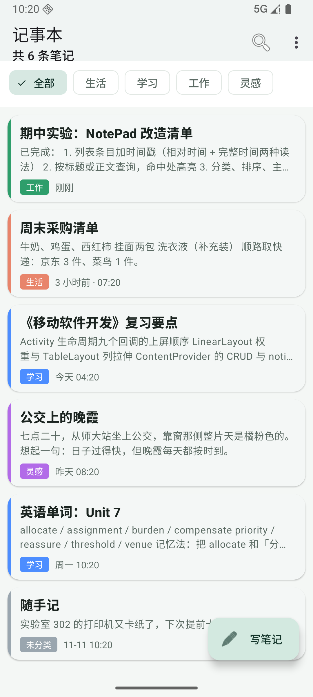
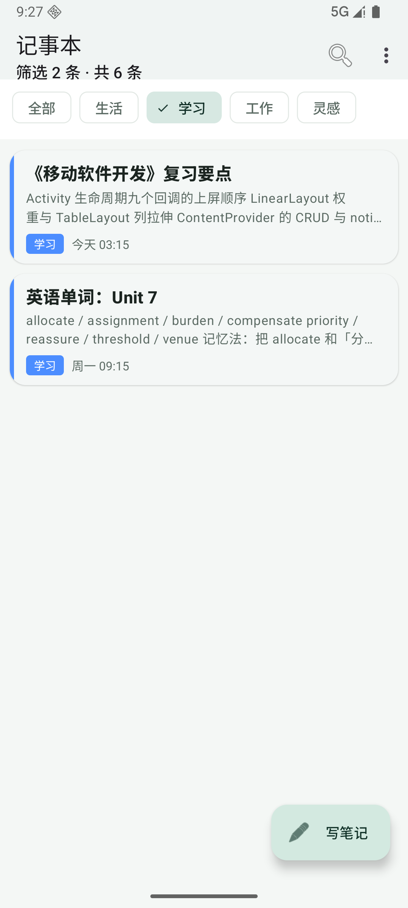
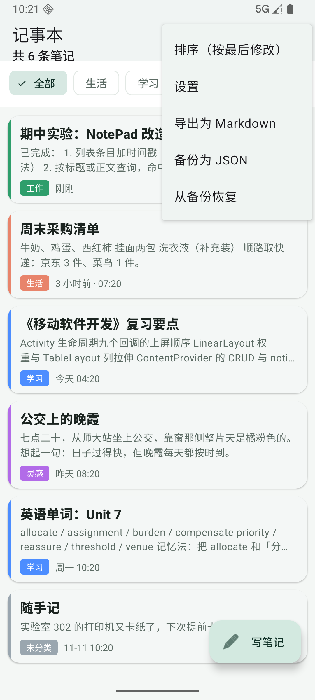
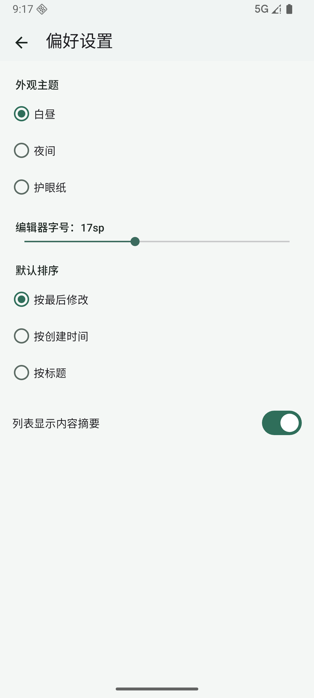
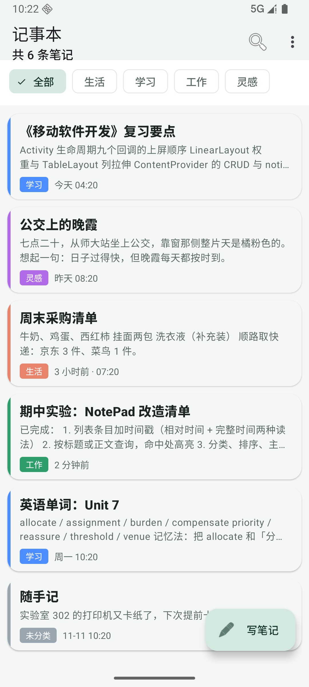
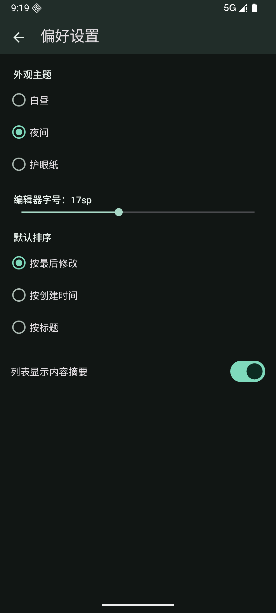
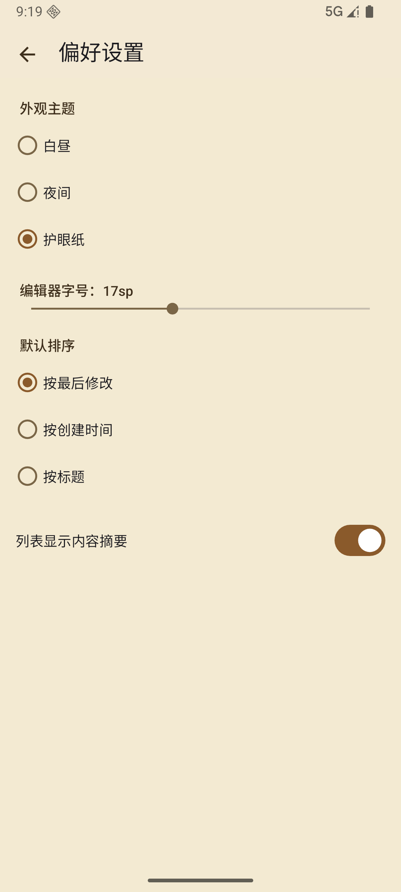
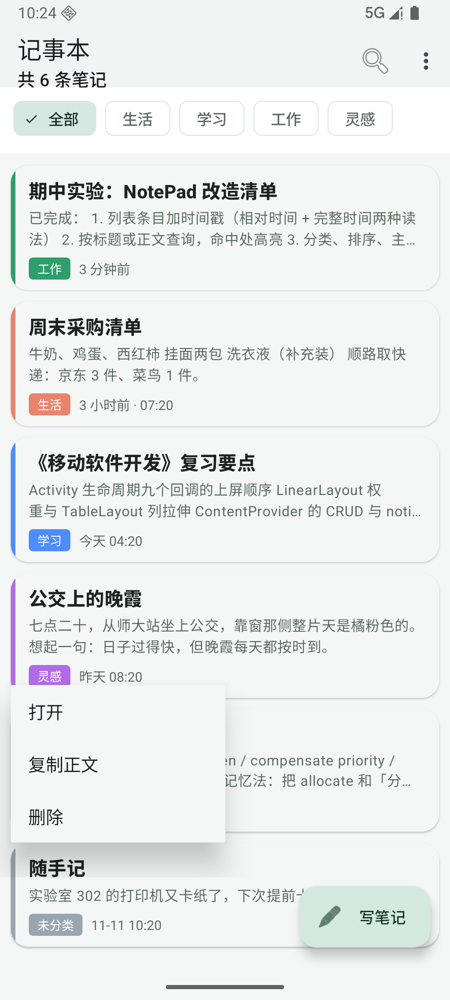
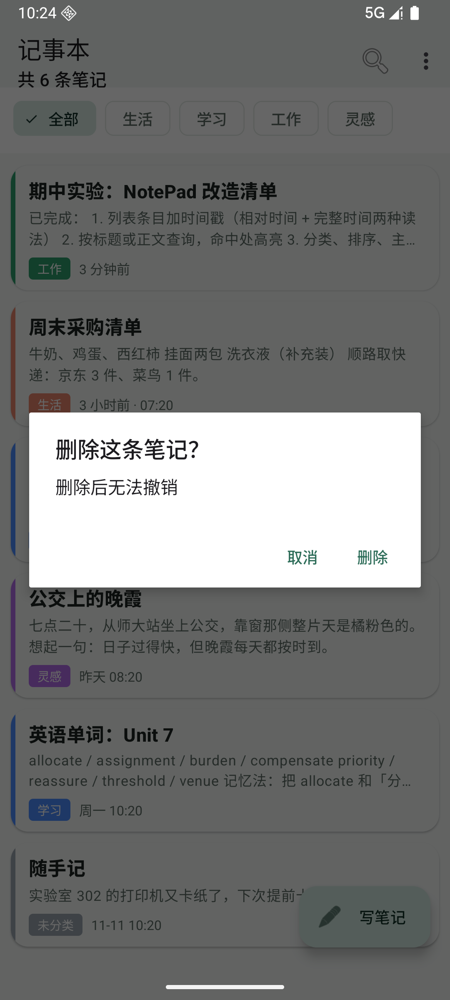
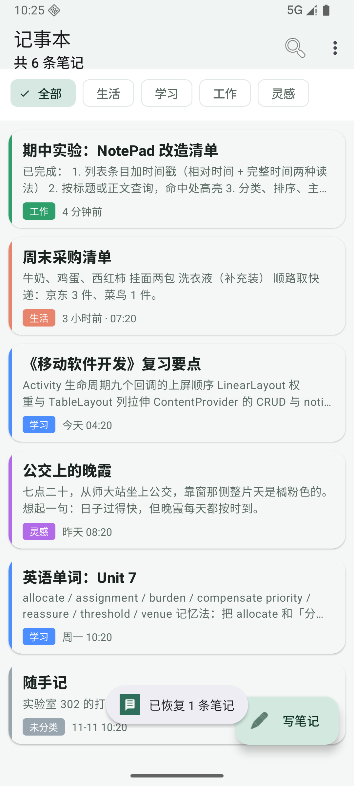

# 期中实验 · NotePad 记事本应用改造（MidtermNotePad）

《移动软件开发》期中实验：以 AOSP 的 NotePad 示例为底子，先补齐「列表条目显示时间戳」「按标题或正文查询」两项基本要求，再按课件给出的方向做五类附加功能——主题美化、笔记分类、笔记排序、导出与备份恢复、偏好设置。

> **交付状态：已完成**（tag `midterm`）。19 张实机截图见 `screenshots/`，`run-debug.bat` 可一键编译安装。
>
> **图文版实验记录**：CSDN 博客（待发布，发布后在此补链接）

## 需求对照

| 课件要求 | 本项目对应 | 截图 |
| --- | --- | --- |
| 基本 ①：列表条目加时间戳 | 每条笔记显示「刚刚 / 3 小时前 · 06:15 / 今天 03:15 / 昨天 07:15 / 周一 09:15 / 11-11 09:15」的分级相对时间，编辑页再给完整时间 | 01、04 |
| 基本 ②：按标题或内容查询 | 工具栏 `SearchView`，`title LIKE ? OR note LIKE ?`，命中关键词黄底加粗高亮，输入 220ms 防抖 | 02 |
| 附加 ①：美化 UI、更换背景 | 白昼 / 夜间 / 护眼纸三套主题，卡片式列表、分类色条、`ExtendedFAB` | 06–10 |
| 附加 ②：笔记分类 | 生活 / 学习 / 工作 / 灵感 / 未分类，列表顶部 chip 筛选，编辑器里选分类 | 03、04 |
| 附加 ③：笔记排序 | 按最后修改 / 按创建时间 / 按标题；菜单项标题直接写着当前排序，点开是一个单选对话框，勾完即生效并自动关闭 | 05、05-sort-dialog、05-sort-by-title |
| 附加 ④：导出与备份 | 导出 Markdown、备份 JSON 到 `Download/NotePad`，从备份恢复（同标题同修改时间视为已存在，自动去重） | 11、12、16、17 |
| 附加 ⑤：偏好设置 | 主题、编辑器字号（12–24sp）、默认排序、列表摘要开关 | 06–09 |
| 附加 ⑥：笔记便签（未做） | — | — |

## 截图

| 列表（时间戳 + 分类色条） | 搜索「Activity」，命中处高亮 |
| --- | --- |
|  |  |

| 分类筛选「学习」 | 编辑页（创建/修改时间、字数、分类） |
| --- | --- |
|  |  |

| 溢出菜单（排序 / 设置 / 导出 / 备份 / 恢复） | 偏好设置（白昼） |
| --- | --- |
|  |  |

| 排序：单选对话框（勾完即生效，点「取消」直接退出） | 选「按标题」后的列表顺序 |
| --- | --- |
|  |  |

| 偏好设置（夜间） | 列表（夜间） |
| --- | --- |
|  |  |

| 偏好设置（护眼纸） | 列表（护眼纸） |
| --- | --- |
|  |  |

| 导出 Markdown 完成 | 备份 JSON 完成 |
| --- | --- |
|  |  |

| 长按条目（打开 / 复制正文 / 删除） | 删除确认 |
| --- | --- |
|  |  |

| 删除一条后剩 5 条 | 从备份恢复：选文件 |
| --- | --- |
|  |  |

| 恢复完成（只补回删掉的那 1 条） |
| --- |
|  |

## 各功能的关键做法

### 01 沿用 NotePad 的 ContentProvider 架构

- 保留 AOSP 示例的命名习惯（`NotePad.Notes.CONTENT_URI`、`COLUMN_NAME_TITLE` / `COLUMN_NAME_NOTE`），authority 改成 `com.example.midtermnotepad.provider`，库名 `notepad.db`。
- 表结构在原有 `title / note / created / modified` 上加了 `category`，数据库版本升到 2；`onUpgrade` 用 `ALTER TABLE … ADD COLUMN` 兼容老库，不做破坏性重建。
- 增删改一律 `notifyChange`，列表挂 `ContentObserver` 自动刷新——搜索框里正在输入、后台在恢复备份，列表都会自己更新，不用手动 `reload()`。

### 02 时间戳分级（基本要求一）

- `TimeUtil` 只做一件事：给一个毫秒值，返回当前语境下最省钱的写法。
  - 1 分钟内 → `刚刚`；1 小时内 → `x 分钟前`；今天 → `今天 HH:mm`；昨天 → `昨天 HH:mm`；一周内 → `周X HH:mm`；更早 → `MM-dd HH:mm`。
- 编辑页保留完整时间（`2026-11-18 09:15`），列表用相对时间，两种读法各管一摊：列表要「多久以前」，编辑页要「具体哪一刻」。

### 03 查询（基本要求二）

- `SearchView` 的 `OnQueryTextListener` 里启一个 220ms 的 `Handler` 防抖，避免每敲一个字母都查一次库。
- 查询在单线程 `Executor` 上跑（`NoteStore.query` → 主线程回填），不在主线程碰 Cursor。
- 命中高亮用 `SpannableString` + `BackgroundColorSpan`：先在标题里找关键词，没有再在正文里找，并把摘要**围绕命中处**截取，保证高亮部分一定在可见范围内。

### 04 分类（附加要求）

- 分类用 `int` 存在表里（`-1 未分类 / 0 生活 / 1 学习 / 2 工作 / 3 灵感`），中文名与色值集中在 `UI` 里，列表色条、徽标、编辑页 chip 共用一份，不会三处颜色对不上。
- 列表顶部 `ChipGroup` 是单选筛选：点「学习」只剩 2 条，副标题同步改成「筛选 2 条 · 共 6 条」，避免「共 6 条却只看到 2 条」的疑惑。

### 05 排序（附加要求）

- 三种排序共用一个 `sortOrder(int)`：`modified DESC` / `created DESC` / `title COLLATE NOCASE ASC`。
- 排序**不用菜单子菜单**：`PopupMenu` 的子菜单进得去、退不出来——Android 没有「返回上一级」的控件，要么把整份菜单关掉重开，要么自己塞一项「返回」再 `show()` 父菜单（会闪一下，很别扭）。改成菜单项「排序（当前模式）」+ 一个 `setSingleChoiceItems` 对话框：勾完立刻生效并自动关闭，「取消」和系统返回键都能直接退出，一屏之内就把当前排序看全了。
- 设置页里另有一个「默认排序」，下次进列表就按它来。

### 06 主题与偏好（附加要求）

- `values/themes.xml` 里三套主题继承同一个 `Base.NotePad`：`Theme.NotePad.Light`（浅绿主色 `#2F6E5A`）、`Theme.NotePad.Dark`、`Theme.NotePad.Sepia`（护眼纸）。
- 三套主题都把 M3 的 `primary / secondary / tertiary` 容器色、`surfaceContainer*` 系列、`outlineVariant` 补齐了——不补的话，Material3 组件（尤其 FilterChip 的选中态）会漏出默认紫色。
- 切换主题后 `recreate()`，`UI.applyTheme()` 在 `super.onCreate()` 之前调，保证重建时用的是新主题；edge-to-edge 的状态栏图标明暗也跟着主题走（深色主题用浅色图标）。

### 07 导出 / 备份 / 恢复（附加要求）

- API 29+ 用 `MediaStore.Downloads` 写入公共下载目录（`Download/NotePad`），不需要存储权限；更低版本退到应用专属外部目录。
- 导出 Markdown：标题 + 分类 + 创建/修改时间 + 正文，按当前筛选结果导出。
- 备份 JSON：带去重判断——**同标题且同修改时间**视为同一条，恢复时跳过；因此「备份 6 条 → 删 1 条 → 恢复」只会补回 1 条，不会把另外 5 条复制一遍。
- 恢复要保留原时间戳，所以插入后立刻 `update` 回 `created / modified`；`NotePadProvider` 的 `insert` 原本无条件把 `modified` 写成当前时间，改成了「调用方给了就尊重，没给才打当前时间」。

### 08 演示数据

- `Seed` 只在 debuggable 包、且库为空时写入 6 条中文示例笔记（带错开的时间戳），保证一进 App 就能看到时间戳分级、分类色条、搜索高亮都工作；正常 release 包不会写演示数据。
- 演示文案本身也得说得通：第 4 条写的是「公交上的晚霞」，公交在地面上跑，靠窗才看得到天色；放在地铁里就不合逻辑了（车厢在地下，抬头只有扶手和广告）。

## 构建与运行

```powershell
cd midterm-notepad
.\gradlew.bat --stop
.\gradlew.bat assembleDebug --console=plain
adb install -r app\build\outputs\apk\debug\app-debug.apk
adb shell am start -n com.example.midtermnotepad/.NotesListActivity
```

或直接双击本目录下的 `run-debug.bat`。

包名 `com.example.midtermnotepad`，应用名「记事本 · 期中实验」，`minSdk 24` / `targetSdk 37`，AGP 9.4.1 + Gradle 9.6.0，纯 Java（无 Compose、无 Kotlin）。

## 踩坑记录

1. **`NoActionBar` 主题下不 `setSupportActionBar(toolbar)`，菜单等于没写**：工具栏上搜索图标、溢出菜单一个都不会出现，`onCreateOptionsMenu` 也不会被回调。加上这一句之后菜单才挂到 `MaterialToolbar` 上。
2. **`ActionBar` 标题不吃 `setTitle()`**：`Activity.setTitle()` 只改窗口标题，`ActionBar` 仍显示 `android:label`（「记事本」）。改用 `getSupportActionBar().setTitle("编辑笔记")`。
3. **Provider 无条件覆盖 `modified`**：原示例 `insert/update` 里直接 `values.put(MODIFIED, now)`，种子数据和恢复的备份全部显示「刚刚」。改成尊重调用方传入的值，只有没传才补当前时间。
4. **PowerShell 写 Java 文件会带 BOM**：`Set-Content -Encoding UTF8` 写出 UTF-8 **带 BOM**，javac 直接报 `非法字符: '\ufeff'` + 后续一整串「需要 class, interface 或 enum」。改文件一律用 `[IO.File]::WriteAllText($path, $text, (New-Object Text.UTF8Encoding($false)))`。
5. **构建失败但安装照样 Success**：`adb install -r` 装的是上一次构建的 APK，`BUILD FAILED` 被后面的 `Success` 掩盖，表现为「改了代码，界面纹丝不动」。判据是 APK 的修改时间，别只看 install 的输出。
6. **`application/json` 的备份文件在系统文件选择器里「看不见」**：`ACTION_OPEN_DOCUMENT` 的 Documents 根目录只列出部分类型，必须从侧栏进「Download → NotePad」才看得到 `.json`。另外把 MIME 改成 `text/plain` 会规避过滤，但 MediaStore 会把文件名补成 `…json.txt`，更乱——所以最终保留 `application/json`，恢复入口只按 json 过滤，README 里写清路径。
7. **`adb` 输出偶发被吞 / 长命令被转后台**：`& $adb devices` 有时返回空，可靠做法是重定向到文件再 `Get-Content`；构建这类长命令用 `TaskOutput` 取结果。
8. **坐标必须从 `uiautomator dump` 取**：截图是 1080×2400，但渲染出来的预览图被缩放，目测坐标乘 1.2 才对得上；直接 dump 的 `bounds` 才是设备像素。
9. **模拟器没设备时**：`Start-Process "D:\Android\Sdk\emulator\emulator.exe" -ArgumentList "-avd","Pixel7API36","-no-snapshot-load"`，再轮询 `sys.boot_completed=1`。
10. **`PopupMenu` 子菜单没有「返回上一级」**：`<item>` 里套 `<menu>` 做出来的二级菜单，选完想退回去只能把整份菜单重开；原地加「返回」项再 `show()` 父菜单会闪、位置也跳。最终把排序改成普通菜单项 + 单选对话框，顺带把「当前排的是哪种」写进菜单标题，省掉「两个勾」这种要靠记忆的交互。

## 目录结构

```
midterm-notepad/
├─ app/src/main/
│  ├─ java/com/example/midtermnotepad/
│  │  ├─ NotePad.java              契约类（authority / 列名 / 分类常量）
│  │  ├─ NotePadProvider.java      ContentProvider（CRUD + notifyChange + 升级兼容）
│  │  ├─ NoteStore.java            查询 / 计数 / 增删改 / 三种排序
│  │  ├─ NoteItem.java             列表用的一条笔记
│  │  ├─ TimeUtil.java             相对时间与完整时间
│  │  ├─ Prefs.java                主题 / 字号 / 默认排序 / 摘要开关
│  │  ├─ UI.java                   主题应用、edge-to-edge、分类色与名、摘要截取
│  │  ├─ NoteAdapter.java          列表 Adapter + ViewHolder
│  │  ├─ NotesListActivity.java    列表：搜索、筛选、排序、菜单、导出/备份/恢复
│  │  ├─ NoteEditorActivity.java   编辑：标题、正文、分类、元信息、自动保存
│  │  ├─ SettingsActivity.java     偏好设置
│  │  ├─ ExportBackup.java         Markdown 导出 / JSON 备份 / 恢复去重
│  │  └─ Seed.java                 仅 debuggable 的演示数据
│  ├─ res/layout/                  activity_notes_list / item_note / activity_note_editor / activity_settings
│  ├─ res/menu/                    menu_list.xml / menu_editor.xml
│  ├─ res/values/                  strings / colors / themes（三套）
│  └─ res/drawable/                ic_back / ic_empty_note / ic_launcher_note / bg_category
├─ screenshots/                    实机运行截图（1080×2400）
└─ run-debug.bat                   一键编译安装
```

## 作者

**wjjj-ge**（[@wjjj-ge](https://github.com/wjjj-ge)）· 福建师范大学 · 计算机与网络空间安全学院 · 软件工程专业

课程：《移动软件开发》· 2026 年秋季学期 · 期中实验（NotePad 记事本应用）
