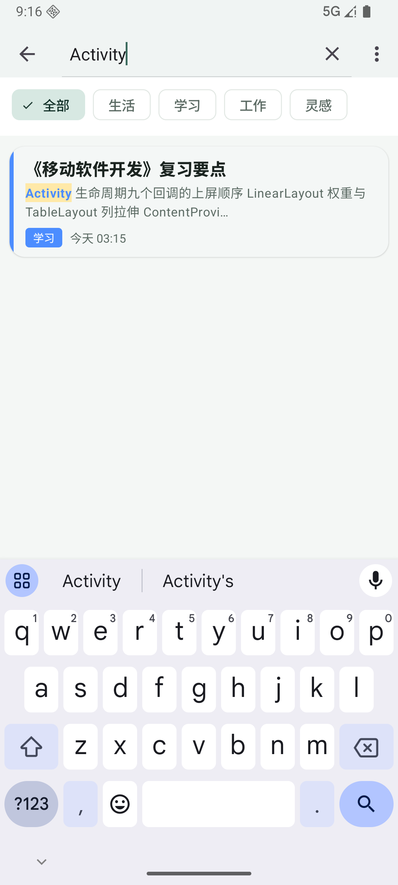
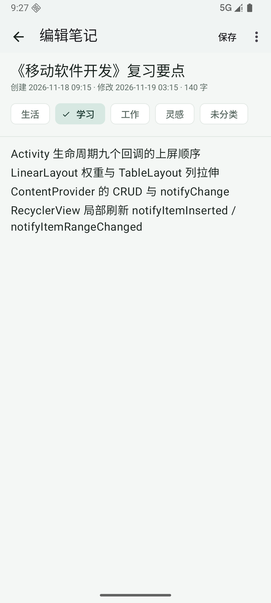
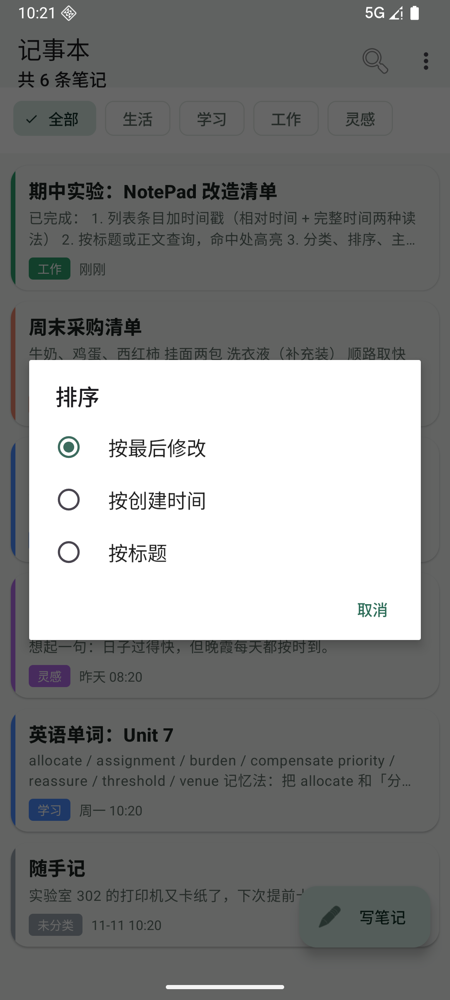
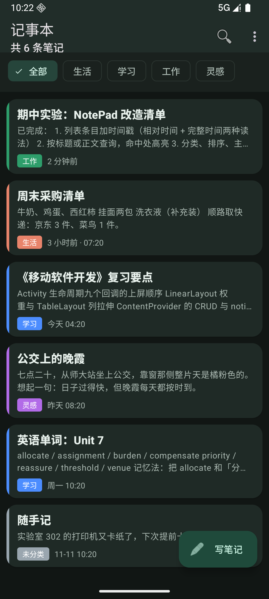
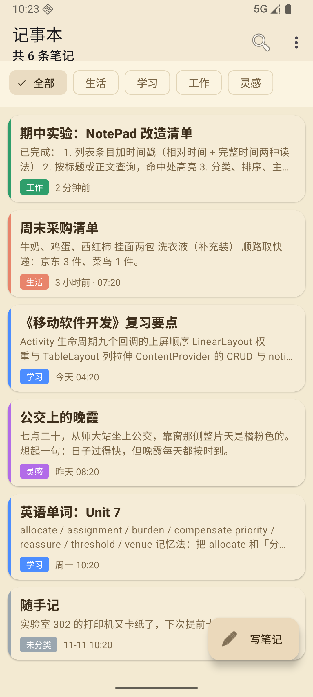
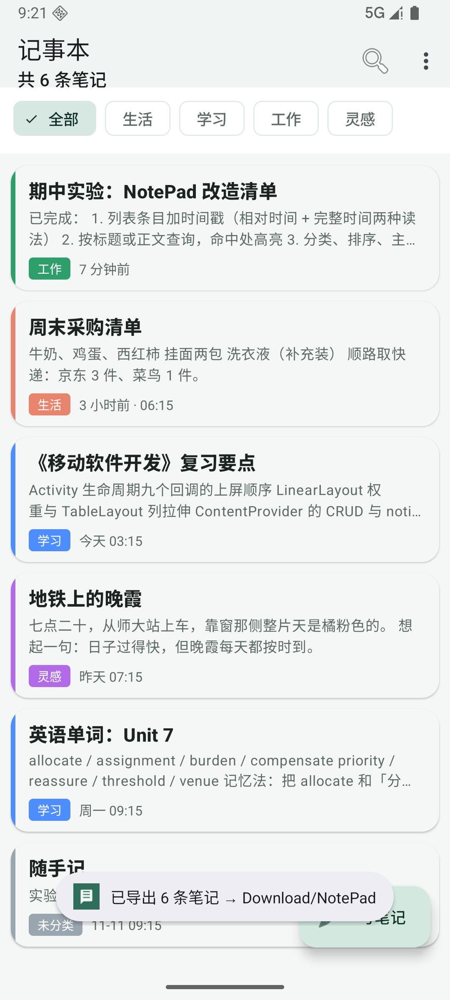
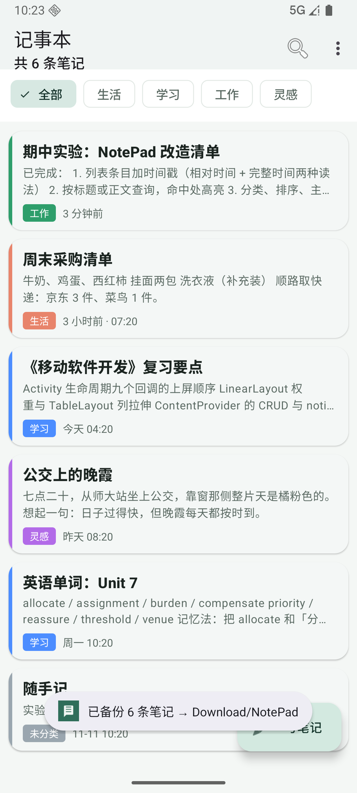
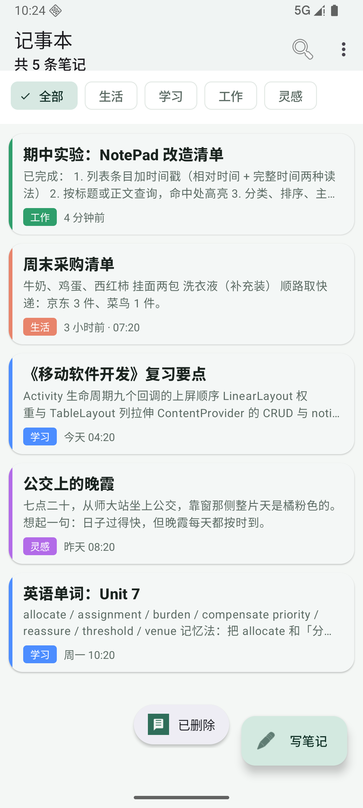
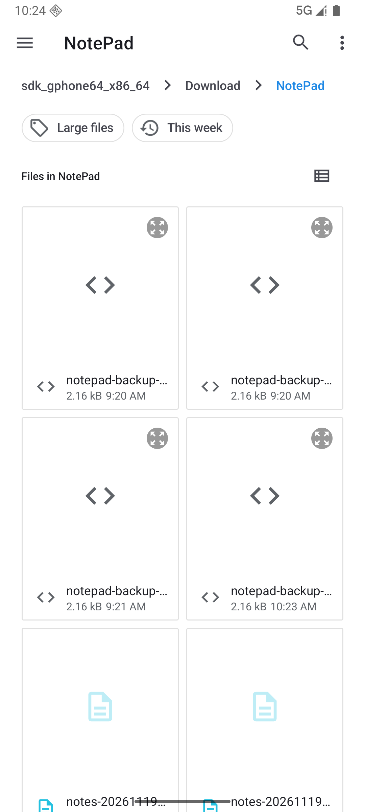

# 期中实验 · NotePad 记事本应用改造（MidtermNotePad）

《移动软件开发》期中实验项目。以 AOSP 的 NotePad 示例为底子，保留 `ContentProvider + ContentResolver` 架构，补齐「列表时间戳」「标题/正文查询」两项基本要求，并在其之上扩展五类附加功能：三套主题、笔记分类、笔记排序、导出与备份恢复、偏好设置。

- **源码**：<https://github.com/wjjj-ge/fjnu-mobile-app-dev-labs>（`midterm-notepad/` 目录，默认分支 `main`）
- **图文说明**：[CSDN 博客 · 期中实验 NotePad 记事本应用改造](https://blog.csdn.net/wjjj_ge/article/details/171106541)
- **交付状态**：已完成。21 张实机截图见 `screenshots/`，双击 `run-debug.bat` 可一键编译安装。

---

## 一、项目概览

| 项 | 值 |
| --- | --- |
| 应用名 | 记事本 · 期中实验 |
| 包名 / 入口 | `com.example.midtermnotepad` / `.NotesListActivity` |
| 语言 | 纯 Java（无 Kotlin、无 Compose） |
| 构建 | AGP 9.4.1 + Gradle 9.6.0 + JDK 21 |
| 平台 | `minSdk 24` / `targetSdk 37` / `compileSdk 37` |
| 数据存储 | `ContentProvider` + SQLite（库名 `notepad.db`，版本 2） |
| 实测环境 | AVD `Pixel7API36`（Android 16 / API 36 / 1080×2400 / 420dpi） |
| 代码规模 | 13 个 Java 类、4 个布局、2 个菜单资源、3 套主题 |
| 界面结构 | 列表页（`NotesListActivity`）→ 编辑页（`NoteEditorActivity`）／设置页（`SettingsActivity`） |

## 二、功能一览（用户视角）

| 功能 | 入口 | 行为 |
| --- | --- | --- |
| 笔记列表 | 启动页 | 每条显示标题、摘要、分类徽标、分级时间戳；左侧色条对应分类 |
| 时间戳 | 列表 / 编辑页 | 列表用相对时间（刚刚 / x 分钟前 / 今天 / 昨天 / 周X / MM-dd），编辑页用绝对时间 |
| 搜索 | 工具栏放大镜 | 标题或正文模糊匹配，命中处黄底加粗高亮，摘要围绕命中处截取；中英文均可 |
| 分类筛选 | 列表顶部 chip | 全部 / 生活 / 学习 / 工作 / 灵感 单选，副标题同步「筛选 N 条 · 共 M 条」 |
| 新建 / 编辑 | 右下 `ExtendedFAB`／点条目 | 标题、正文、分类；创建与修改时间、字数实时显示；离开页面自动保存 |
| 长按操作 | 长按条目 | 打开 / 复制正文到剪贴板 / 删除（删除需二次确认） |
| 排序 | 溢出菜单首项 | 菜单项标题写着当前排序（如「排序（按最后修改）」），点开单选对话框，勾完即生效 |
| 主题 | 溢出菜单 → 设置 | 白昼 / 夜间 / 护眼纸，即时切换，状态栏图标明暗跟随 |
| 编辑器字号 | 设置页 | 12–24sp 滑杆，正文实时变化 |
| 默认排序 | 设置页 | 下次进入列表按该排序显示 |
| 列表摘要 | 设置页 | 可关闭，长文列表更紧凑 |
| 导出 | 溢出菜单 | 按当前筛选结果导出 Markdown 至 `Download/NotePad` |
| 备份 / 恢复 | 溢出菜单 | 备份为 JSON；从系统选择器选文件恢复，同标题同修改时间的条目不重复插入 |

> 课件写的是「附加功能至少两项」，本项目做了五项（UI 美化、分类、排序、导出与恢复、偏好设置）。
> 建议列表中的「多类型笔记（图片/语音/视频）」「语音搜索」「笔记便签」「OCR 扫描」未实现。

## 三、需求对照

| 课件要求 | 本项目对应 | 截图 |
| --- | --- | --- |
| 基本 ①：列表条目加时间戳 | 六档相对时间 + 编辑页绝对时间 | 01、04 |
| 基本 ②：按标题或内容查询 | `SearchView` + `title LIKE ? OR note LIKE ?` + 命中高亮 | 02、02-search-zh、02-search-zh-2 |
| 附加：美化 UI / 换背景 | 白昼 / 夜间 / 护眼纸三套主题，卡片式列表、分类色条、`ExtendedFAB` | 06–10 |
| 附加：笔记分类 | 生活 / 学习 / 工作 / 灵感 / 未分类，chip 筛选 + 编辑器选择 | 03、04 |
| 附加：笔记排序 | 三种排序，菜单项标题显示当前模式，单选对话框切换 | 05、05-sort-dialog、05-sort-by-title |
| 附加：导出与备份恢复 | Markdown 导出、JSON 备份、去重恢复 | 11、12、16、17 |
| 附加：偏好设置 | 主题、字号、默认排序、摘要开关 | 06–09 |

## 四、界面截图

| 列表（时间戳 + 分类色条） | 搜索「Activity」，命中处高亮 |
| --- | --- |
|  |  |

| 搜索「牛奶」（中文关键词，筛出 1 条） | 搜索「实验」（标题 + 正文各命中 1 条） |
| --- | --- |
|  |  |

| 分类筛选「学习」 | 编辑页（创建/修改时间、字数、分类） |
| --- | --- |
|  |  |

| 溢出菜单（排序 / 设置 / 导出 / 备份 / 恢复） | 偏好设置（白昼） |
| --- | --- |
|  |  |

| 排序：单选对话框（勾完即生效，点「取消」直接退出） | 选「按标题」后的列表顺序 |
| --- | --- |
|  |  |

| 偏好设置（夜间） | 列表（夜间） |
| --- | --- |
|  |  |

| 偏好设置（护眼纸） | 列表（护眼纸） |
| --- | --- |
|  |  |

| 导出 Markdown 完成 | 备份 JSON 完成 |
| --- | --- |
|  |  |

| 长按条目（打开 / 复制正文 / 删除） | 删除确认 |
| --- | --- |
|  |  |

| 删除一条后剩 5 条 | 从备份恢复：选文件 |
| --- | --- |
|  |  |

| 恢复完成（只补回删掉的那 1 条） |
| --- |
|  |

## 五、架构说明

三层，依赖方向单向，没有反向依赖：

```
┌────────────────────────────────────────────────────────────┐
│ UI 层                                                      │
│  NotesListActivity   列表：搜索 / 筛选 / 排序 / 菜单 / 导出 │
│  NoteEditorActivity  编辑：标题 / 正文 / 分类 / 自动保存     │
│  SettingsActivity    偏好设置                               │
│  NoteAdapter         列表 Adapter（高亮、摘要、色条）        │
├────────────────────────────────────────────────────────────┤
│ 业务与工具层                                                │
│  NoteStore   查询 / 计数 / 增删改 / 三种排序（同步，调用方放子线程）│
│  ExportBackup Markdown 导出 / JSON 备份 / 恢复去重          │
│  TimeUtil     相对时间与绝对时间                            │
│  Prefs        SharedPreferences 读写                        │
│  UI           主题应用 / edge-to-edge / 分类配色 / 摘要截取  │
│  Seed         演示数据（仅 debuggable 且库为空时写入）       │
├────────────────────────────────────────────────────────────┤
│ 数据层                                                      │
│  NotePad          契约类（authority / 表名 / 列名 / 分类常量）│
│  NotePadProvider  ContentProvider（CRUD + notifyChange）     │
│  SQLite notepad.db（表 notes，版本 2）                       │
└────────────────────────────────────────────────────────────┘
```

数据流的关键一条：**增删改一律 `notifyChange`，列表挂 `ContentObserver` 自动刷新**。所以「后台恢复备份」「编辑页保存返回」都不需要手动刷新列表，也不会出现"数据变了界面还是旧的"。

## 六、数据模型

```sql
CREATE TABLE notes (
    _id      INTEGER PRIMARY KEY AUTOINCREMENT,
    title    TEXT,      -- 标题，可空
    note     TEXT,      -- 正文，可空
    created  INTEGER,   -- 创建时间（毫秒）
    modified INTEGER,   -- 最后修改时间（毫秒）
    category INTEGER    -- 分类：-1 未分类 / 0 生活 / 1 学习 / 2 工作 / 3 灵感
);
```

- **升级策略**：`onUpgrade` 用 `ALTER TABLE notes ADD COLUMN category INTEGER`，不重建表、不清数据；旧库升上来分类默认取 `-1`。
- **时间戳语义**：`created` 只在首次插入时写一次；`modified` 在每次更新时写。`NotePadProvider.insert()` 尊重调用方传入的值，只有没传才补当前时间（否则备份恢复出来的笔记会全部显示「刚刚」，见第九节踩坑 3）。
- **分类常量**集中定义在 `NotePad` 与 `UI`：中文名与色值只有一份，列表色条、徽标、编辑器 chip 共用。

备份 JSON 结构：

```json
{
  "app": "midterm-notepad",
  "exportedAt": 1763572800000,
  "notes": [
    {
      "title": "周末采购清单",
      "note": "牛奶、鸡蛋、西红柿 挂面两包 …",
      "category": 0,
      "created": 1763490000000,
      "modified": 1763490000000
    }
  ]
}
```

## 七、关键实现

### 1 沿用 NotePad 的 ContentProvider 架构

- 保留原示例命名（`NotePad.Notes.CONTENT_URI`、`COLUMN_NAME_TITLE` / `COLUMN_NAME_NOTE`），authority 改为 `com.example.midtermnotepad.provider`，库名 `notepad.db`。
- 表结构在原 `title / note / created / modified` 上加 `category`，数据库版本升到 2。
- 增删改 `notifyChange` + 列表 `ContentObserver` 自动刷新。

### 2 时间戳分级（基本要求一）

`TimeUtil.relative()` 只做一件事：给一个毫秒值，返回当前语境下最省事的写法。

| 距今 | 显示 |
| --- | --- |
| < 1 分钟 | `刚刚` |
| < 1 小时 | `x 分钟前` |
| 今天且 < 6 小时 | `x 小时前 · HH:mm` |
| 今天 | `今天 HH:mm` |
| 昨天 | `昨天 HH:mm` |
| 一周内 | `周X HH:mm` |
| 更早 | `MM-dd HH:mm` |

编辑页另用 `absolute()` 输出 `2026-11-18 09:15`。两种读法各管一摊：列表要「多久以前」，编辑页要「具体哪一刻」。

### 3 查询（基本要求二）

- `SearchView` 的 `OnQueryTextListener` 里挂 220ms `Handler` 防抖，避免每个字符都查库。
- 查询跑在单线程 `Executor`（`NoteStore.query`），结果回主线程回填，不在主线程碰 `Cursor`。
- 命中高亮用 `SpannableString` + `BackgroundColorSpan` + `StyleSpan(BOLD)`。
- **摘要围绕命中处截取**（`UI.snippet`）：前面留 24 字上下文、后面留 60 字，两端省略补 `…`——否则关键词落在第 300 字，用户搜到了却在屏幕上什么也看不见。

### 4 分类

- 分类用 `int` 存：`-1 未分类 / 0 生活 / 1 学习 / 2 工作 / 3 灵感`。
- 列表顶部 `ChipGroup` 单选筛选，副标题同步「筛选 2 条 · 共 6 条」——两个数都写出来，避免「共 6 条却只看到 2 条」的疑惑。

### 5 排序

- 三种排序共用一个 `sortOrder(int)`：`modified DESC` / `created DESC` / `title COLLATE NOCASE ASC`。
- **不用菜单子菜单**：`PopupMenu` 的子菜单进得去、退不出来（Android 没有「返回上一级」控件，塞「返回」项再 `show()` 父菜单会闪、位置还跳）。改成菜单项「排序（当前模式）」+ `setSingleChoiceItems` 对话框，勾完即时生效并自动关闭，「取消」与系统返回键都能直接退出。
- 菜单项标题动态写当前排序（`menu_sort_with` = 「排序（%1$s）」），避免「两个勾分不清」要靠记忆。
- 设置页另有「默认排序」，下次进列表生效。

### 6 主题与偏好

- `values/themes.xml` 三套主题继承同一个 `Base.NotePad`：`Theme.NotePad.Light`（主色 `#2F6E5A`）、`Theme.NotePad.Dark`、`Theme.NotePad.Sepia`。
- 三套都补齐了 M3 的 `primary / secondary / tertiary` 容器色、`surfaceContainer*`、`outlineVariant`——不补，`FilterChip` 选中态会漏出默认紫色。
- `UI.applyTheme()` 必须在 `super.onCreate()` **之前**调用，否则 `recreate()` 上来还是旧主题。
- API 36 强制 edge-to-edge：状态栏与导航栏透明，系统栏高度以 padding 让给页头与底部列表（不用 `fitsSystemWindows`，避免色带）；状态栏图标明暗跟随主题。

### 7 导出 / 备份 / 恢复

- API 29+ 走 `MediaStore.Downloads` + `RELATIVE_PATH` 写入 `Download/NotePad`，**不需要存储权限**；更低版本退到应用专属外部目录。
- 导出 Markdown：标题 + 分类 + 创建/修改时间 + 正文，按当前筛选结果导出。
- 备份 JSON 带去重判断：**同标题且同修改时间**视为同一条，恢复时跳过。因此「备份 6 条 → 删 1 条 → 恢复」只补回 1 条。
- 恢复要保留原时间戳：插入后立刻 `update` 回 `created / modified`。

### 8 演示数据

`Seed` 只在 debuggable 包、且库为空时写入 6 条中文示例笔记（时间戳错开），保证一进 App 就能看到六档时间格式、分类色条、搜索高亮都在工作；release 包不写。
文案本身也讲逻辑：第 4 条是「公交上的晚霞」而不是「地铁上的晚霞」——地铁在地下跑，窗外看不到天色。

## 八、构建与运行

环境要求：JDK 21、Android SDK（`compileSdk 37`）、一台 API 24+ 的设备或模拟器。

```powershell
cd midterm-notepad
.\gradlew.bat --stop
.\gradlew.bat assembleDebug --console=plain
adb install -r app\build\outputs\apk\debug\app-debug.apk
adb shell am start -n com.example.midtermnotepad/.NotesListActivity
```

或直接双击本目录下的 `run-debug.bat`（脚本会自动定位 SDK 里的 adb）。

### 复位演示数据

```powershell
adb shell pm clear com.example.midtermnotepad
```

`pm clear` 会清空数据库与偏好（主题、字号、排序全部回默认），下次启动重新播种 6 条演示笔记。

### debug 搜索注入（仅自测/截图）

包里有一个只在 debug 生效的入口，用于在没有中文输入法的模拟器上验证中文查询。命令在**电脑终端**（PowerShell / Android Studio Terminal）里敲：

```powershell
cd D:\Android\Sdk\platform-tools
.\adb.exe shell am force-stop com.example.midtermnotepad   # 页面已在前台时必须先杀，否则 intent 只送到旧页面
.\adb.exe shell am start -n com.example.midtermnotepad/.NotesListActivity --es debug_query 牛奶
# 终端把中文参数吃掉时改传 Base64（UTF-8）：--es debug_query_b64 <base64>
```

读 `debug_query` / `debug_query_b64` 两个 extra，填进 `SearchView` 后走正常 `LIKE` 查询；`FLAG_DEBUGGABLE` 守卫，release 包跳过。

> 注：`gradle.properties` 里 `android.aapt2FromMavenOverride` 是指向本机 `build-tools/36.0.0/aapt2.exe` 的绝对路径，换机需改成自己的 SDK 路径；`local.properties` 不入库。

## 九、测试与验证

全部在 AVD `Pixel7API36`（Android 16 / API 36 / 1080×2400）实机操作，截图未裁剪。

| 验证项 | 方法 | 结果 | 证据 |
| --- | --- | --- | --- |
| 时间戳六档 | 造 6 条时间错开的笔记，同屏观察 | 刚刚 / 分钟前 / 小时前 / 今天 / 昨天 / 周X 均出现 | `01` |
| 英文查询 | 搜「Activity」 | 命中列表页并高亮 | `02` |
| 中文查询 | 搜「牛奶」/「实验」 | 1 条 / 2 条，标题与正文各高亮 | `02-search-zh*` |
| 分类筛选 | 点「学习」 | 剩 2 条，副标题「筛选 2 条 · 共 6 条」 | `03` |
| 编辑与保存 | 进编辑页改正文后返回 | 列表自动刷新，`modified` 变为当前 | `04` |
| 排序 | 对话框选「按标题」 | 顺序变为《移动软件开发》复习要点 → 公交上的晚霞 → … | `05-sort-by-title` |
| 主题 | 依次切夜间 / 护眼纸 | 列表与设置页同步换色，状态栏图标正确 | `07`–`10` |
| 导出 | 菜单 → 导出 | Toast「已导出 6 条笔记 → Download/NotePad」 | `11` |
| 备份 | 菜单 → 备份 | Toast「已备份 6 条笔记」，`Download/NotePad` 出现 json | `12`、`16` |
| 删除 | 长按 → 删除 → 确认 | 剩 5 条，Toast「已删除」 | `13`–`15` |
| 恢复去重 | 恢复到 6 条数据里 | Toast「已恢复 1 条笔记」，只补回删掉的那条 | `17` |

自查顺序（新机器上复现一遍）：

1. `pm clear` → 启动 → 应看到 6 条演示数据、六档时间戳；
2. 搜一个中英混合关键词（如 `NotePad`）→ 高亮位置在摘要可见区；
3. 切「按标题」→ 顺序变化；切回「按最后修改」→ 恢复；
4. 备份 → 删一条 → 恢复 → 条目数回到 6，且时间戳没变成「刚刚」；
5. 切夜间 → 状态栏图标是浅色的，页面没有白底闪。

## 十、已知限制

- **仅在一台 1080×2400 手机上验证**，未测平板 / 折叠屏 / 横屏布局。
- **中文输入靠系统输入法**：自测用的模拟器没有中文 IME（`adb input text 中文` 会抛 `NullPointerException`），所以中文查询的截图走 debug 注入入口；正常使用需真机或装中文输入法。
- **排序按标题是 SQLite 字节序**（`COLLATE NOCASE` 只忽略大小写，不懂拼音），中文标题不按拼音排。
- **备份去重键是「标题 + 修改时间」**：理论上两条同标题且落在同一毫秒的笔记会被误判为同一条（实际几乎不会发生），恢复是整文件全量比较，不做单条挑选。
- **导出为全量/筛选结果导出**，不支持只导出选中条目。
- **无富文本**：正文是纯文本，图片 / 语音 / 视频笔记、OCR、便签贴纸均未实现。
- **演示数据仅 debug 包**，release 首次启动是空列表（这是刻意设计）。
- **`aapt2FromMavenOverride` 为绝对路径**，换机 / 换盘符需手动改。

## 十一、版本记录

| 提交 / 标签 | 说明 |
| --- | --- |
| `b1d7c3f`（tag **`midterm-first`**） | 期中实验首版交付：五类附加功能、17 张截图 |
| `18f2317` | 根 README 增加期中实验索引行 |
| `a20f637` | `run-debug.bat` 支持自动定位 adb |
| `0446337` | 排序改为单选对话框（子菜单没有「返回上一级」）、演示文案改公交、重拍受影响的 10 张截图 |
| `d9ebb3b` | 根 README 索引更新为 19 张截图 |
| `a918f79` | README 补记「模拟器无中文输入法」这条坑 |
| `c4e3921` | debug 包支持 `debug_query` 注入，补中文搜索截图（19 → 21 张） |
| `ea6b6e9` | README 写明搜索注入命令要在电脑终端执行、页面前台先 `force-stop` |
| `c288c81` | README 扩充为完整项目说明（功能一览、架构、数据模型、验证矩阵、已知限制、版本记录） |
| `50b1694` | README 与根目录 README 回填 CSDN 博客链接 |
| 最终交付（tag **`midterm`**） | 指向上一条提交之后的最终状态：排序单选对话框、中文搜索截图（21 张）、完整项目说明与博客链接 |

> **两个标签的分工**：`midterm-first` 固定冻结 11-18 的首版交付 `b1d7c3f`（17 张截图、排序还是子菜单），作为"按期交付"的时间点留证；`midterm` 指向最终版，老师按标签查看会看到排序对话框与中文搜索。**日常查看直接看默认分支 `main` 即可，两者内容一致。**

## 十二、踩坑记录

1. **`NoActionBar` 主题下不 `setSupportActionBar(toolbar)`，菜单等于没写**：工具栏上搜索图标、溢出菜单一个都不出现，`onCreateOptionsMenu` 也不回调。
2. **`ActionBar` 标题不吃 `setTitle()`**：`Activity.setTitle()` 只改窗口标题，`ActionBar` 仍显示 `android:label`（「记事本」）。编辑页要显示「编辑笔记」得 `getSupportActionBar().setTitle(...)`。
3. **Provider 无条件覆盖 `modified`**：原示例 `insert` 直接 `values.put(MODIFIED, now)`，种子数据与恢复出来的笔记全部显示「刚刚」。改成尊重调用方传入的值。
4. **PowerShell 写 Java 文件会带 BOM**：`Set-Content -Encoding UTF8` 写出 UTF-8 **带 BOM**，javac 报 `非法字符: '\ufeff'` 加一整串「需要 class, interface 或 enum」。改文件一律 `[IO.File]::WriteAllText($p, $s, (New-Object Text.UTF8Encoding($false)))`。
5. **构建失败但安装照样 Success**：`adb install -r` 装的是上一次的 APK，`BUILD FAILED` 被后面的 `Success` 掩盖，表现成「改了代码界面纹丝不动」。判据是 APK 修改时间。
6. **`application/json` 的备份在系统文件选择器里看不见**：`ACTION_OPEN_DOCUMENT` 根目录只列部分类型，得从侧栏进「Download → NotePad」。改 MIME 为 `text/plain` 能绕过滤，但 MediaStore 会把文件名补成 `…json.txt`，更乱。
7. **`adb` 输出偶发被吞 / 长命令被转后台**：重定向到文件再 `Get-Content`；构建这类长命令取后台任务输出。
8. **坐标要 `uiautomator dump`**：截图 1080×2400，渲染后的预览图被缩过，目测坐标乘 1.2 才对得上；`dump` 的 `bounds` 才是设备像素（我第一次点「按标题」点在「按最后修改」行内，白排查十分钟）。
9. **模拟器没设备时**：`Start-Process "D:\Android\Sdk\emulator\emulator.exe" -ArgumentList "-avd","Pixel7API36","-no-snapshot-load"`，再轮询 `sys.boot_completed=1`。
10. **`PopupMenu` 子菜单没有「返回上一级」**：见第七节 5，最终改成菜单项 + 单选对话框。
11. **模拟器打不出中文 ≠ 搜索不支持中文**：`ime list` 里只有 Gboard(English US)，`adb shell input text 牛奶` 抛 `NullPointerException`；用 stdin 喂 SQL 给应用库验证 `like '%牛奶%'` 命中「周末采购清单」，证明查询与语言无关。`ADBKeyboard` 在 API 36 上广播 `result=0` 也没跑通，最终用 `debug_query` 注入收尾。

## 十三、目录结构

```
midterm-notepad/
├─ app/src/main/
│  ├─ java/com/example/midtermnotepad/
│  │  ├─ NotePad.java              契约类（authority / 列名 / 分类常量）
│  │  ├─ NotePadProvider.java      ContentProvider（CRUD + notifyChange + 升级兼容）
│  │  ├─ NoteStore.java            查询 / 计数 / 增删改 / 三种排序
│  │  ├─ NoteItem.java             列表用的一条笔记
│  │  ├─ TimeUtil.java             相对时间与绝对时间
│  │  ├─ Prefs.java                主题 / 字号 / 默认排序 / 摘要开关
│  │  ├─ UI.java                   主题应用、edge-to-edge、分类色与名、摘要截取
│  │  ├─ NoteAdapter.java          列表 Adapter + ViewHolder
│  │  ├─ NotesListActivity.java    列表：搜索、筛选、排序、菜单、导出/备份/恢复
│  │  ├─ NoteEditorActivity.java   编辑：标题、正文、分类、元信息、自动保存
│  │  ├─ SettingsActivity.java     偏好设置
│  │  ├─ ExportBackup.java         Markdown 导出 / JSON 备份 / 恢复去重
│  │  └─ Seed.java                 仅 debuggable 的演示数据
│  ├─ res/layout/                  activity_notes_list / item_note / activity_note_editor / activity_settings
│  ├─ res/menu/                    menu_list.xml / menu_editor.xml
│  ├─ res/values/                  strings / colors / themes（三套）
│  └─ res/drawable/                ic_back / ic_empty_note / ic_launcher_note / bg_category
├─ screenshots/                    实机运行截图（1080×2400，21 张）
├─ run-debug.bat                   一键编译安装
└─ README.md                       本文件
```

## 十四、作者

**wjjj-ge**（[@wjjj-ge](https://github.com/wjjj-ge)）· 福建师范大学 · 计算机与网络空间安全学院 · 软件工程专业

课程：《移动软件开发》· 2026 年秋季学期 · 期中实验（NotePad 记事本应用改造）

---

> 本项目为课程作业，代码可自由参考；引用请注明出处。
